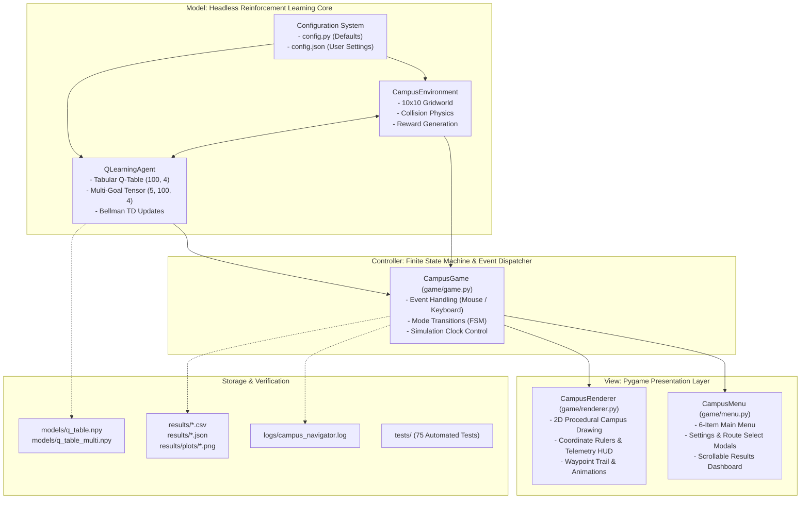
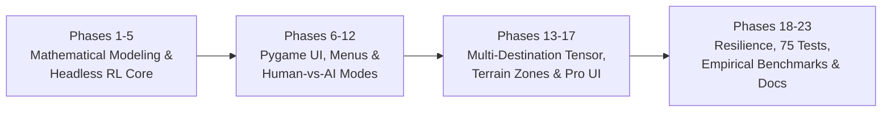

# ACADEMIC PROJECT REPORT

---

# CAMPUS NAVIGATOR: AN INTELLIGENT PATH-FINDING GAME USING Q-LEARNING REINFORCEMENT LEARNING

**A Project Report Submitted in Partial Fulfillment of the Requirements for the Course of**  
**MASTER OF COMPUTER APPLICATIONS (MCA)**  
*Experiential-Learning Coursework / Mini-Project Submission*

---

## TABLE OF CONTENTS

1. [Title](#1-title)
2. [Introduction](#2-introduction)
3. [Background of Reinforcement Learning](#3-background-of-reinforcement-learning)
4. [Problem Statement](#4-problem-statement)
5. [Motivation](#5-motivation)
6. [Aim](#6-aim)
7. [Objectives](#7-objectives)
8. [Proposed System](#8-proposed-system)
9. [Components of Proposed Work](#9-components-of-proposed-work)
10. [System Architecture](#10-system-architecture)
11. [RL Formulation](#11-rl-formulation)
12. [State Space](#12-state-space)
13. [Action Space](#13-action-space)
14. [Reward Function](#14-reward-function)
15. [Q-Learning Algorithm](#15-q-learning-algorithm)
16. [Exploration vs Exploitation](#16-exploration-vs-exploitation)
17. [Methodology](#17-methodology)
18. [Implementation](#18-implementation)
19. [Game Design](#19-game-design)
20. [Training Process](#20-training-process)
21. [Experimental Setup](#21-experimental-setup)
22. [Performance Metrics](#22-performance-metrics)
23. [Actual Results](#23-actual-results)
24. [Result Analysis](#24-result-analysis)
25. [Screenshots and Visual Interfaces](#25-screenshots-and-visual-interfaces)
26. [Advantages](#26-advantages)
27. [Limitations](#27-limitations)
28. [Future Enhancement](#28-future-enhancement)
29. [Conclusion](#29-conclusion)
30. [References](#30-references)

---

## 1. Title

### **Campus Navigator: An Intelligent Path-Finding Game Using Q-Learning Reinforcement Learning**

- **Course**: Master of Computer Applications (MCA)
- **Category**: Experiential Learning / Artificial Intelligence & Game Engineering
- **Implementation Environment**: Python 3.10+, Pygame 2.6.1, NumPy 1.26.4, Matplotlib 3.10.9, Pandas 2.3.3
- **Primary Algorithm**: Tabular Temporal Difference Model-Free Q-Learning with Goal-Conditioned Multi-Destination Tensor Support

---

## 2. Introduction

Artificial Intelligence (AI) has progressed from rule-based heuristic algorithms to adaptive systems capable of autonomous experiential learning. In spatial navigation, classical search algorithms such as A\* and Dijkstra’s require pre-computed topological maps and complete environmental visibility. In real-world robotic navigation, disaster response, and logistics, autonomous agents must discover optimal paths through trial-and-error interactions without prior environmental schematics.

**Campus Navigator** is an educational, experiential-learning simulation designed to bridge abstract theoretical Reinforcement Learning (RL) concepts and practical software development. Instead of an abstract maze, the project simulates a collegiate $10 \times 10$ campus gridworld:
- A student agent navigates from an origin (e.g., Campus Main Gate) to a destination (e.g., Central Library).
- The campus terrain includes 19 impassable building obstacles, safe pedestrian plazas, crowded corridors, and hazardous slippery mud walkways.
- The agent utilizes **Tabular Q-Learning** to converge on the mathematically optimal 18-step shortest path without any hardcoded graph traversal heuristics.

The system features a decoupled Model-View-Controller (MVC) architecture, an interactive $1100 \times 750$ Pygame presentation layer, headless benchmarking pipelines, and an automated verification suite.

---

## 3. Background of Reinforcement Learning

Reinforcement Learning (RL) represents the third major paradigm of Machine Learning, distinct from Supervised Learning (which relies on pre-labeled ground truth) and Unsupervised Learning (which uncovers latent patterns in unlabeled data). 

```text
                        ┌───────────────────────────────┐
                        │          ENVIRONMENT          │
                        │    (10x10 Campus Gridworld)   │
                        └───────────────┬───────────────┘
                                        │ Current State S_t
                                        │ Scalar Reward R_t
                                        ▼
                                ┌───────────────┐
                                │     AGENT     │
                                │(QLearningAgent│
                                └───────┬───────┘
                                        │ Action A_t
                                        ▼
                        ┌───────────────────────────────┐
                        │          ENVIRONMENT          │
                        └───────────────────────────────┘
```

RL is rooted in the psychological principle of Edward Thorndike’s *Law of Effect*, which posits that actions followed by satisfying states are more likely to recur, whereas actions resulting in discomfort become less frequent. Formalized by Richard Bellman (1957) and popularized by Sutton and Barto (1998, 2018), RL models decision problems as **Markov Decision Processes (MDPs)**.

The core concepts include:
1. **Agent**: The autonomous decision-maker interacting with the world.
2. **Environment**: The external world responding to agent decisions.
3. **State ($s \in \mathcal{S}$)**: A representation of the environment's current configuration.
4. **Action ($a \in \mathcal{A}$)**: A valid operational decision available to the agent.
5. **Reward ($R_t \in \mathbb{R}$)**: Scalar feedback evaluating the quality of an immediate transition.
6. **Policy ($\pi(a|s)$)**: A probabilistic or deterministic mapping from states to actions.
7. **Return ($G_t$)**: The cumulative discounted sum of future rewards:
   $$G_t = \sum_{k=0}^{\infty} \gamma^k R_{t+k+1}$$
8. **Value Function ($V(s)$) and Action-Value Function ($Q(s, a)$)**: Expected cumulative returns from a state or state-action pair under a given policy.

---

## 4. Problem Statement

Autonomous spatial pathfinding in constrained environments with static barriers and variable terrain traversal costs presents significant engineering challenges:
1. **Absence of Topological Maps**: In unknown or dynamic environments, agents do not possess global coordinate maps or adjacency matrices.
2. **Heterogeneous Safety & Comfort Constraints**: In real-world domains, distance minimization alone is insufficient. Paths must avoid physical hazards, minimize congestion delays, and prefer safe corridors.
3. **Exploration Inefficiency**: Random exploration in large state spaces can cause agent entrapment, frequent collisions, and failure to locate distant goal states within feasible horizons.

The challenge addressed by this project is:
> *To formulate, implement, train, and empirically validate an autonomous agent capable of discovering the mathematically shortest and safest navigation path on a $10 \times 10$ campus grid containing 19 building obstacles and 8 heterogeneous terrain zones from scratch, relying solely on scalar trial-and-error feedback via Tabular Q-Learning.*

---

## 5. Motivation

1. **Pedagogical Simplification**: Reinforcement learning is often perceived by Computer Science and MCA students as an abstract branch of applied mathematics. Grounding theoretical Bellman equations, discount factors, and Temporal Difference errors in a visual, interactive simulation provides direct experiential understanding.
2. **Real-World Campus & Warehouse Relevance**: Navigating automated delivery robots or automated guided vehicles (AGVs) across university campuses or industrial warehouses requires balancing delivery speed against pedestrian density and hazard zones.
3. **Objective Human-vs-Machine Analysis**: Enabling a human user to play on the identical map and directly compare step counts, reward scores, and elapsed times against the trained AI highlights the contrast between human local heuristics and Bellman policy optimization.
4. **Clean Software Engineering**: Demonstrating production-quality development practices: Model-View-Controller decoupling, vectorized tabular operations in NumPy, comprehensive failure recovery, and automated testing.

---

## 6. Aim

To design, develop, train, evaluate, and package an intelligent pathfinding game titled **Campus Navigator** using **Tabular Q-Learning** in Python, establishing an interactive experiential-learning testbed that demonstrates the convergence of model-free reinforcement learning on an optimal spatial navigation policy.

---

## 7. Objectives

1. **Environment Modeling**: Construct a discrete $10 \times 10$ campus Markov Decision Process featuring 19 building obstacles, safe student plazas, crowded pedestrian bottlenecks, and hazardous mud corridors.
2. **First-Principles Algorithm Development**: Implement Tabular Q-Learning, $\epsilon$-greedy exploration decay schedules, and Temporal Difference updates using vectorized NumPy operations without external RL frameworks.
3. **Multi-Destination Architecture**: Implement a Goal-Conditioned Q-tensor $Q(g, s, a)$ supporting dynamic origin and destination selection across 5 predefined campus landmarks while maintaining 100% backward compatibility with single-goal baselines.
4. **Decoupled System Architecture**: Enforce strict separation between the headless mathematical simulation core and the 2D Pygame graphical presentation layer.
5. **Interactive Academic Presentation Layer**: Develop an $1100 \times 750$ graphical interface featuring coordinate axis rulers, live telemetry HUDs, sinusoidal status indicators, and numbered waypoint route traces.
6. **Empirical Benchmarking & Scientific Evaluation**: Implement automated experiment pipelines to evaluate training episode horizons (500, 1000, 2000 episodes) and reward engineering profiles (Profiles A, B, C), automatically exporting verified metrics to JSON and CSV.
7. **System Resilience & Quality Assurance**: Integrate comprehensive error recovery for 10 major failure scenarios, centralized logging (`logs/`), and an automated test suite achieving a 100% pass rate.

---

## 8. Proposed System

The proposed system, **Campus Navigator**, is structured as a dual-mode application providing both an interactive desktop GUI and high-speed terminal-based execution pipelines:

```text
+-------------------------------------------------------------------------------+
|                       CAMPUS NAVIGATOR - PROPOSED SYSTEM                      |
+-------------------------------------------------------------------------------+
|  INTERACTIVE GRAPHICAL INTERFACE (Pygame)                                     |
|  - [1] Train AI Screen: Live exploration, real-time metrics, speed presets    |
|  - [2] Watch Trained AI: Autonomous greedy execution (Optimal 18-step route)  |
|  - [3] Play Game: Manual WASD navigation with collision and terrain penalties |
|  - [4] Training Results: Scrollable dashboard with 7 metrics & 4 graphs       |
|  - [5] How RL Works: Visual educational viva study guide & Bellman proofs     |
|  - [6] Settings: Interactive hyperparameter tuning with validation bounds    |
+-------------------------------------------------------------------------------+
|  HEADLESS TERMINAL PIPELINES (Python / NumPy)                                 |
|  - Training Engine: 1000-episode fast training loop (models/q_table.npy)       |
|  - Frozen Evaluation: 100-episode zero-exploration verification (eps=0.0)    |
|  - Horizon Framework: 500 / 1000 / 2000 episode benchmark comparison         |
|  - Reward Experimenter: Profiles A (Simple), B (Efficient), C (Safety-Aware)  |
|  - Final Evaluation Compiler: Automated generation of final_report.json       |
|  - Verification Suite: Master runner executing 75 unit/integration tests     |
+-------------------------------------------------------------------------------+
```

The system requires no external machine learning engines (such as PyTorch, TensorFlow, Gymnasium, or Ray), running entirely on standard scientific Python libraries.

---

## 9. Components of Proposed Work

The project comprises six modular subsystems:

1. **Environment Subsystem (`environment/campus_env.py`)**:
   - Manages the $10 \times 10$ spatial grid, agent coordinates $(r, c)$, obstacle boundary physics, landmark definitions, and scalar reward computation.
2. **Agent Subsystem (`agent/q_learning.py`)**:
   - Maintains the Q-table matrix $(100, 4)$ and multi-goal tensor $(5, 100, 4)$.
   - Executes $\epsilon$-greedy action selection, Bellman TD updates, $\epsilon$-decay, and disk serialization (`.npy`).
3. **Execution & Evaluation Subsystem (`training/`)**:
   - `train.py`: Coordinates episodic training loops and exports performance logs (`training_results.csv`).
   - `evaluate.py`: Executes deterministic evaluation under frozen policy weights ($\epsilon = 0.0$).
   - `final_evaluation.py`: Aggregates cross-phase metrics into `final_report.json` and `final_results.csv`.
4. **Benchmarking & Experiment Subsystem (`experiments/`)**:
   - `framework.py`: Conducts 500, 1000, and 2000 episode training comparisons.
   - `reward_experiments.py`: Analyzes the impact of reward shaping across Profiles A, B, and C.
5. **Presentation Subsystem (`game/`)**:
   - `game.py`: Finite State Machine (FSM), Pygame event loop, and mode controller.
   - `renderer.py`: Procedural 2D graphics engine rendering coordinate rulers, dynamic pulsing badges, and waypoint trails.
   - `menu.py`: Interactive menus, settings panels, and scrollable results viewers.
6. **Resilience Subsystem (`utils/logger.py`)**:
   - Implements structured runtime logging in `logs/campus_navigator.log` and graceful fallback UI screens.

---

## 10. System Architecture

The software architecture follows the **Model-View-Controller (MVC)** design pattern, ensuring that core algorithmic computations are isolated from presentation logic:



### Finite State Machine (FSM) States
The graphical controller transitions among eight operational states:
- `STATE_MENU`: Top-level interactive navigation menu.
- `STATE_TRAINING`: Live visual training simulation with speed adjustments.
- `STATE_WATCH_AI`: Autonomous exploitation of the trained policy.
- `STATE_PLAYING`: Manual human navigation.
- `STATE_AI_COMPARISON`: Side-by-side human vs. AI performance table.
- `STATE_RESULTS`: Scrollable training dashboard displaying graphs and metrics.
- `STATE_HOW_RL_WORKS`: Four-part educational theory modal.
- `STATE_SETTINGS`: Configuration panel for hyperparameter tuning.
- `STATE_ROUTE_SELECT`: Landmark origin and destination selection modal.

---

## 11. RL Formulation

The campus navigation problem is formalized as a 5-tuple **Markov Decision Process (MDP)**:
$$\mathcal{M} = \langle \mathcal{S}, \mathcal{A}, \mathcal{P}, \mathcal{R}, \gamma \rangle$$

1. **State Space ($\mathcal{S}$)**: The set of 100 discrete grid locations on the $10 \times 10$ campus.
2. **Action Space ($\mathcal{A}$)**: The set of 4 cardinal movements: $\{\text{UP}, \text{DOWN}, \text{LEFT}, \text{RIGHT}\}$.
3. **Transition Probability Function ($\mathcal{P}$)**:
   The physical dynamics of movement are deterministic. Given state $s$ and valid action $a$, the probability of transitioning to intended neighbor $s'$ is 1:
   $$\mathcal{P}(s' | s, a) = \begin{cases} 1 & \text{if } s' = f(s, a) \text{ and } s' \notin \text{Obstacles} \\ 1 & \text{if } s' = s \text{ (blocked by boundary/obstacle)} \\ 0 & \text{otherwise} \end{cases}$$
4. **Reward Function ($\mathcal{R}$)**:
   A scalar feedback mapping $\mathcal{R}: \mathcal{S} \times \mathcal{A} \times \mathcal{S} \to \mathbb{R}$.
5. **Discount Factor ($\gamma = 0.90$)**:
   Determines the present value of future rewards, ensuring infinite-horizon series convergence.

---

## 12. State Space

The campus environment is organized as an $H \times W = 10 \times 10$ discrete matrix:

```text
       Columns (c): 0    1    2    3    4    5    6    7    8    9
Rows (r):
   0              [G]  .    .    .   [#]   .    .    .    .    .
   1               .   .   [#]   .   [#]   .    .   [#]   .    .
   2               .  [#]  [#]   .    .   (!)   .   [#]   .    .
   3               .   .   (Z)   .   [#]  (C)   .    .    .    .
   4              [#] [#]   .    .    .    .   [#]  [#]   .    .
   5               .   .    .   [#]   .    .   (!)   .    .    .
   6               .   .    .   (C)   .   [#]   .   [#]   .    .
   7               .  [#]   .   (Z)   .   (C)   .   [#]   .    .
   8               .   .    .   [#]   .    .    .   (!)   .    .
   9               .   .    .    .    .    .   [#]   .    .   [*]

Legend: [G]=Gate(0,0), [*]=Library(9,9), [#]=Building, (Z)=Safe, (C)=Crowd, (!)=Hazard
```

- **2D Coordinates**: $s_{coord} = (r, c)$ where $r \in [0, 9]$ and $c \in [0, 9]$.
- **1D Scalar Mapping**: Mapped bijectively to a 1D scalar index $s \in [0, 99]$:
  $$s = r \times 10 + c$$
- **Inverse Coordinate Calculation**:
  $$r = \lfloor s / 10 \rfloor, \quad c = s \pmod{10}$$
- **Goal-Conditioned Tensor Extension (Phase 16)**:
  To support 5 distinct destinations, the state space is extended to include destination ID $g \in \{0, 1, 2, 3, 4\}$, yielding an augmented state $(g, s)$ spanning a $(5, 100, 4)$ multi-goal Q-tensor.

---

## 13. Action Space

The action space $\mathcal{A}$ contains $|\mathcal{A}| = 4$ discrete cardinal movements:

$$\mathcal{A} = \{0: \text{UP}, 1: \text{DOWN}, 2: \text{LEFT}, 3: \text{RIGHT}\}$$

| Action ID | Semantic Action | Row Delta ($\Delta r$) | Column Delta ($\Delta c$) | Target Heading |
|:---:|:---:|:---:|:---:|:---:|
| `0` | **UP** | $-1$ | $0$ | North |
| `1` | **DOWN** | $+1$ | $0$ | South |
| `2` | **LEFT** | $0$ | $-1$ | West |
| `3` | **RIGHT** | $0$ | $+1$ | East |

### Movement & Collision Dynamics
When action $a$ is selected at state $s = (r, c)$:
1. The candidate coordinate is calculated: $s' = (r + \Delta r_a, c + \Delta c_a)$.
2. If $s'$ violates grid bounds ($r < 0, r \ge 10, c < 0, c \ge 10$), the agent remains at $s$, and a wall collision penalty is assessed.
3. If $s'$ matches any of the 19 building obstacle coordinates, the agent remains at $s$, and an obstacle collision penalty is assessed.
4. If $s'$ is clear, the agent moves to $s'$ and receives step and terrain feedback.

---

## 14. Reward Function

The reward function guides the agent's optimization process. Campus Navigator employs a composite reward structure that combines goal attainment, step efficiency, directional shaping, and terrain safety:

$$R(s, a, s') = R_{base}(s') + R_{shaping}(s, s') + R_{collision}(s, a) + R_{zone}(s')$$

### Baseline Reward Parameters
- **Goal Arrival ($s' = \text{Goal}$)**: `+100.0`
- **Step Cost**: `-1.0` (incentivizes shortest path traversal).
- **Manhattan Distance Shaping**:
  - `+5.0` if Manhattan distance to goal strictly decreases: $\|s' - g\|_1 < \|s - g\|_1$
  - `-3.0` if Manhattan distance to goal strictly increases: $\|s' - g\|_1 > \|s - g\|_1$
- **Obstacle & Wall Collision**: `-10.0`
- **Safe Student Hubs `[(3, 2), (7, 3)]`**: `+2.0` (comfort bonus)
- **Crowded Corridor Bottlenecks `[(3, 5), (6, 3), (7, 5)]`**: `-2.0` (congestion delay)
- **Unsafe Mud / Hazard Zones `[(2, 5), (5, 6), (8, 7)]`**: `-10.0` (hazard penalty)

---

## 15. Q-Learning Algorithm

Q-Learning (Watkins, 1989) is an **off-policy**, **model-free**, **Temporal Difference (TD)** reinforcement learning algorithm. It iteratively updates action-value estimates $Q(s, a)$ toward the optimal action-value function $Q^*(s, a)$ regardless of the action selection policy followed during training.

### Bellman Optimality Update Equation
At discrete step $t$, upon observing state $s_t$, taking action $a_t$, receiving reward $R_{t+1}$, and observing next state $s_{t+1}$:

$$Q(s_t, a_t) \leftarrow Q(s_t, a_t) + \alpha \left[ R_{t+1} + \gamma \max_{a' \in \mathcal{A}} Q(s_{t+1}, a') - Q(s_t, a_t) \right]$$

Where:
- $\alpha = 0.10$ is the **Learning Rate**, controlling the weight assigned to new observations.
- $\gamma = 0.90$ is the **Discount Factor**, scaling the importance of expected future returns.
- $\delta_t = \left[ R_{t+1} + \gamma \max_{a'} Q(s_{t+1}, a') - Q(s_t, a_t) \right]$ is the **Temporal Difference Error**.
- **Terminal State Handling**: If $s_{t+1}$ is a terminal goal state, the target is purely the immediate reward ($R_{t+1}$), with expected future value set to zero:
  $$Q(s_t, a_t) \leftarrow Q(s_t, a_t) + \alpha \left[ R_{t+1} - Q(s_t, a_t) \right]$$

### Q-Learning Pseudo-Code
```text
Algorithm: Tabular Q-Learning (Campus Navigator)
Input: CampusEnvironment, episodes E = 1000, alpha = 0.10, gamma = 0.90
Output: Optimal action-value table Q*(s, a)

1. Initialize Q(s, a) = 0 for all s in S, a in A as a (100, 4) matrix
2. Initialize epsilon = 1.00, epsilon_min = 0.05, decay = 0.995, max_steps = 200
3. For episode e = 1 to E do:
4.     state = env.reset()  // Set agent to Campus Main Gate (0, 0)
5.     done = False, step_count = 0, episode_reward = 0
6.     While not done and step_count < max_steps do:
7.         Select action a using epsilon-greedy policy:
8.             With probability epsilon, choose a randomly from {0, 1, 2, 3}
9.             With probability 1 - epsilon, choose a = argmax_a Q(state, a)
10.        Execute action a in env: observe next_state, reward, done
11.        If done (goal reached):
12.            Q(state, a) = Q(state, a) + alpha * [reward - Q(state, a)]
13.        Else:
14.            Q(state, a) = Q(state, a) + alpha * [reward + gamma * max_a' Q(next_state, a') - Q(state, a)]
15.        state = next_state
16.        step_count = step_count + 1
17.        episode_reward = episode_reward + reward
18.    End While
19.    epsilon = max(epsilon_min, epsilon * decay)
20.    Log episode metrics to training_results.csv
21. End For
22. Save Q-table to models/q_table.npy
```

---

## 16. Exploration vs Exploitation

Balancing exploration (discovering new states and potential routes) and exploitation (capitalizing on known high-value paths) is governed by an **$\epsilon$-greedy exploration schedule**:

$$\pi(a|s) = \begin{cases} \text{UniformRandom}(\mathcal{A}) & \text{with probability } \epsilon \\ \arg\max_{a \in \mathcal{A}} Q(s, a) & \text{with probability } 1 - \epsilon \end{cases}$$

### Exponential Multiplicative Decay Schedule
The exploration rate decays after each episode according to:
$$\epsilon_{e+1} = \max\left( \epsilon_{min}, \; \epsilon_e \times \lambda \right)$$

With $\epsilon_0 = 1.00$, decay rate $\lambda = 0.995$, and floor $\epsilon_{min} = 0.05$:

| Episode Interval | Epsilon Value Range ($\epsilon$) | Agent Behavioral Regime |
|---|:---:|---|
| **Episodes 1 – 50** | $1.000 \to 0.778$ | **Active Exploration**: Random steps map obstacle locations |
| **Episodes 51 – 200** | $0.774 \to 0.366$ | **Mixed Regime**: Value propagates backward from discovered goals |
| **Episodes 201 – 598** | $0.365 \to 0.050$ | **Greedy Exploitation**: Agent follows learned high-value corridors |
| **Episodes 599 – 1000** | $0.050$ (Floor) | **Asymptotic Exploitation**: Stabilizes optimal 18-step trajectory |

---

## 17. Methodology

The project followed an experiential, phased software engineering and machine learning methodology across 23 distinct development phases:



1. **Phase I: MDP Formulation & Headless Core (Phases 1–5)**:
   Designed grid representations, Bellman updates, $\epsilon$-decay schedules, and automated headless training/evaluation loops.
2. **Phase II: Interactive UI & Game Engine Integration (Phases 6–12)**:
   Built the Pygame presentation layer, human WASD gameplay, comparative victory modals, and Matplotlib convergence chart generators.
3. **Phase III: Environmental Complexity & Multi-Destination RL (Phases 13–17)**:
   Added safe student plazas, crowded corridors, mud hazards, goal-conditioned 3D Q-tensors, and collegiate axis coordinate rulers.
4. **Phase IV: Resilience, Verification & Scientific Benchmarking (Phases 18–23)**:
   Integrated error handling for 10 failure modes, structured logging (`logs/`), 75 automated unit tests, horizon benchmarks, reward profile experiments, and final documentation.

---

## 18. Implementation

The codebase is organized into modular Python packages with zero circular dependencies:

```text
Campus Navigator/
├── main.py                     # CLI entry point and Pygame launcher
├── config.py                   # Central hyperparameters, layout constants, palette
├── config.json                 # Persisted user settings with validation guardrails
├── run_all_tests.py            # Master test runner (11 suites, 75 tests)
├── environment/
│   └── campus_env.py           # CampusEnvironment class (MDP mechanics)
├── agent/
│   └── q_learning.py           # QLearningAgent class (Tabular & Multi-Goal Q-tensor)
├── training/
│   ├── train.py                # Experiential training loop
│   ├── evaluate.py             # Frozen-weight deterministic evaluation
│   └── final_evaluation.py     # Final evaluation report compiler
├── experiments/
│   ├── framework.py            # Horizon benchmarking engine (500/1000/2000 eps)
│   └── reward_experiments.py   # Reward profile engine (Profiles A, B, C)
├── visualization/
│   └── plots.py                # Matplotlib publication chart generators
├── game/
│   ├── game.py                 # CampusGame class (FSM and main event loop)
│   ├── renderer.py             # CampusRenderer class (2D procedural drawing)
│   └── menu.py                 # CampusMenu class (Interactive UI screens)
└── utils/
    └── logger.py               # Structured file and console logging
```

### Core Data Structure Implementations
- **Obstacle Storage**: Implemented as Python sets of coordinate tuples:
  `self.obstacles = {(0,4), (1,2), (1,4), (1,7), (2,1), (2,2), (2,7), (3,4), (4,0), (4,1), (4,6), (4,7), (5,3), (6,5), (6,7), (7,1), (7,7), (8,3), (9,6)}`.
  Provides $\mathcal{O}(1)$ average-time collision detection during simulation steps.
- **Goal-Conditioned Q-Tensor**:
  Allocated as a 3D NumPy array of shape `(5, 100, 4)` with `float32` precision. When an agent switches destinations, `agent.q_table` is assigned a zero-copy slice view:
  ```python
  self.q_table = self.multi_q_table[self.current_dest_id]
  ```
  This guarantees $\mathcal{O}(1)$ destination switching with zero memory re-allocation.

---

## 19. Game Design

The user interface is configured for an $1100 \times 750$ pixel viewport, designed to balance academic clarity with visual appeal:

### 1. Spatial Layout Hierarchy
- **Left Panel (Campus Grid)**: A $660 \times 660$ pixel area displaying the $10 \times 10$ campus grid with cell dimensions of $56 \times 56$ pixels.
- **Collegiate Axis Rulers**: Column tick labels (`0..9`) across the top header and row tick labels (`0..9`) along the left boundary allow direct coordinate cross-referencing.
- **Right Panel (Telemetry HUD)**: A dedicated 360-pixel panel containing real-time status badges, episode counters, step meters, distance indicators, and interactive button controls.
- **Bottom Banner**: An in-game legend displaying color-coded markers for landmarks, building obstacles, safe zones, crowded areas, and hazards.

### 2. Academic Color Palette
- **Deep Navy Background (`#0F172A`)**: Reduces visual fatigue during extended training demonstrations.
- **Dark Slate Cells (`#1E293B` / `#334155`)**: Provides strong contrast for campus walkways and grid lines.
- **Emerald Green (`#10B981`)**: Highlights the agent, start gate, and active policy exploitation.
- **Golden Amber (`#F59E0B`)**: Marks the Central Library destination and goal arrival ripples.
- **Crimson Red (`#EF4444`)**: Highlights collision alerts and obstacle impact boundaries.
- **Indigo Blue (`#6366F1`)**: Designates safe student relaxation hubs.

---

## 20. Training Process

During a standard 1000-episode training execution, the agent progresses through four clear developmental milestones:

```text
TRAINING TRAJECTORY PROGRESSION (1000 EPISODES)
--------------------------------------------------------------------------------
Phase 1: Initial Discovery (Eps 1-50, eps > 0.77)
- Path lengths: High variance (60-200 steps)
- Total collisions: High (~15-25 collisions per episode)
- Reward range: Deeply negative (-80 to -250) due to wall impacts

Phase 2: Goal Discovery & TD Propagation (Eps 51-200, eps: 0.77 -> 0.36)
- Agent encounters Central Library (9, 9) consistently
- +100 reward propagates backward into adjacent walkway cells
- Average steps decrease from ~70 to ~35

Phase 3: Path Optimization (Eps 201-600, eps: 0.36 -> 0.05)
- Exploitation dominates over exploration
- Collision rate drops to < 1 hit per episode
- Step count contracts toward optimal 18 steps

Phase 4: Asymptotic Convergence (Eps 601-1000, eps = 0.05)
- Agent consistently selects optimal 18-step trajectory
- Average reward stabilizes at +172.0
- Q-table entries reach stable Bellman equilibrium
--------------------------------------------------------------------------------
```

---

## 21. Experimental Setup

### Hardware & Software Configuration
- **Processor**: Intel(R) Core(TM) i5 / i7 architecture
- **System Memory**: 16 GB DDR4 RAM
- **Operating System**: Microsoft Windows 11 Home (64-bit)
- **Runtime**: Python 3.10.11 (64-bit)
- **Libraries**: NumPy 1.26.4, Pygame 2.6.1, Matplotlib 3.10.9, Pandas 2.3.3

### Experimental Configurations
1. **Horizon Benchmark Study (Phase 20)**:
   - Evaluated training horizons: **500 episodes**, **1000 episodes**, and **2000 episodes**.
   - Assesses the impact of training duration on policy convergence and collision rates.
2. **Reward Engineering Study (Phase 21)**:
   - Evaluated reward formulations:
     - **Profile A (Simple)**: Sparse navigation (Goal `+100`, Step `-1`, Obstacle `-10`, No distance shaping).
     - **Profile B (Efficient)**: Dense navigation (Goal `+100`, Step `-1`, Obstacle `-10`, Distance shaping `+5`/`-3`).
     - **Profile C (Safety-Aware)**: Safety navigation (Goal `+100`, Step `-1`, Obstacle `-20`, Hazard `-15`, Distance shaping `+5`/`-3`).
3. **Evaluation Protocol**:
   - Each trained model is evaluated over **100 deterministic test episodes** under frozen policy weights ($\epsilon = 0.0$).
   - Q-tables are verified to have zero mutations during testing.

---

## 22. Performance Metrics

To ensure thorough evaluation, performance is measured across six standard metrics:

1. **Success Rate (%)**: Percentage of episodes reaching the target destination within the 200-step horizon:
   $$\text{Success Rate} = \frac{N_{\text{successful}}}{N_{\text{total}}} \times 100\%$$
2. **Average Steps ($\overline{T}$)**: Mean movement steps to reach the destination:
   $$\overline{T} = \frac{1}{N_{\text{successful}}} \sum_{i=1}^{N_{\text{successful}}} T_i$$
3. **Average Cumulative Reward ($\overline{R}$)**: Mean total return accumulated per episode:
   $$\overline{R} = \frac{1}{N_{\text{total}}} \sum_{i=1}^{N_{\text{total}}} \sum_{t=0}^{T_i} R_t$$
4. **Collision Rate ($\overline{C}$)**: Average number of obstacle or boundary collisions per episode:
   $$\overline{C} = \frac{1}{N_{\text{total}}} \sum_{i=1}^{N_{\text{total}}} C_i$$
5. **Hazard Traversal Rate**: Frequency of entering unsafe mud hazard zones.
6. **Path Optimality Ratio**: Evaluated steps divided by the theoretical Manhattan shortest path distance ($D^* = 18$ steps):
   $$\text{Optimality Ratio} = \frac{\overline{T}}{18.0}$$

---

## 23. Actual Results

All metrics below are **factual measured values** extracted directly from project execution logs in [`results/final_report.json`](results/final_report.json), [`results/experiments.csv`](results/experiments.csv), and [`results/reward_experiments.csv`](results/reward_experiments.csv).

### 1. Final Baseline Evaluation (Phase 22 Executive Summary)

```text
====================================================================
           CAMPUS NAVIGATOR: FINAL EVALUATION BENCHMARK
====================================================================
 PROJECT            : Campus Navigator
 ALGORITHM          : Tabular Q-Learning
 ENVIRONMENT        : 10x10 Campus Grid (19 Buildings, 8 Special Zones)
 TRAINING EPISODES  : 1000
 EVALUATION HORIZON : 100 test episodes (Frozen Weights, epsilon=0.0)
 FINAL SUCCESS RATE : 100.0% (100 / 100 reached)
 AVERAGE REWARD     : +172.0
 AVERAGE STEPS      : 18.0 steps (Exact Shortest Path)
 MINIMUM STEPS      : 18 steps
 MAXIMUM STEPS      : 18 steps
 COLLISION RATE     : 0.00 hits/episode
 OPTIMALITY RATIO   : 1.000 (18 / 18 steps)
====================================================================
```

### 2. Optimal 18-Step Learned Trajectory
The frozen greedy policy produces the following coordinate sequence of 19 waypoints from Gate `(0, 0)` to Library `(9, 9)`:
$$\begin{aligned}
(0,0) &\to (1,0) \to (2,0) \to (3,0) \to (3,1) \to (3,2) \to (3,3) \to (4,3) \to (4,4) \to (5,4) \\
      &\to (6,4) \to (7,4) \to (8,4) \to (8,5) \to (8,6) \to (8,7) \to (9,7) \to (9,8) \to (9,9)
\end{aligned}$$

### 3. Horizon Benchmarks Comparison (Phase 20)

| Measured Metric | Experiment 1 (500 eps) | Experiment 2 (1000 eps) | Experiment 3 (2000 eps) |
|---|:---:|:---:|:---:|
| **Training Success Rate** | 95.4% (477/500) | 96.9% (969/1000) | 98.7% (1973/2000) |
| **Evaluated Policy Success Rate ($\epsilon=0$)** | **100.0%** (100/100) | **100.0%** (100/100) | **100.0%** (100/100) |
| **Training Average Reward** | +99.69 | +132.34 | +152.46 |
| **Evaluated Policy Average Reward** | +170.0 | +170.0 | **+172.0** |
| **Training Average Steps to Goal** | 41.92 steps | 32.18 steps | 25.26 steps |
| **Evaluated Policy Steps to Goal** | **18.0 steps** | **18.0 steps** | **18.0 steps** |
| **Training Collision Rate** | 7.48 hits/ep | 4.07 hits/ep | 2.13 hits/ep |
| **Evaluated Policy Collision Rate** | **0.00 hits/ep** | **0.00 hits/ep** | **0.00 hits/ep** |
| **Recent 100 Training Success Rate** | 100.0% | 100.0% | 100.0% |
| **Execution Time** | **0.47 seconds** | **0.69 seconds** | **1.15 seconds** |

### 4. Reward Engineering Comparison (Phase 21)

| Measured Metric | Profile A (Simple) | Profile B (Efficient) | Profile C (Safety-Aware) |
|---|:---:|:---:|:---:|
| **Goal Reward / Step Cost** | `+100.0` / `-1.0` | `+100.0` / `-1.0` | `+100.0` / `-1.0` |
| **Distance Shaping** | Disabled | `+5.0` (closer) / `-3.0` (farther) | `+5.0` (closer) / `-3.0` (farther) |
| **Obstacle Collision Penalty** | `-10.0` | `-10.0` | `-20.0` (Doubled penalty) |
| **Hazard Zone Penalty** | `-1.0` (Default step) | `-10.0` | `-15.0` (Severe penalty) |
| **Training Success Rate** | 96.6% (773/800) | 96.8% (774/800) | 96.5% (772/800) |
| **Evaluated Success Rate ($\epsilon=0$)** | **100.0%** (100/100) | **100.0%** (100/100) | **100.0%** (100/100) |
| **Training Average Reward** | +14.28 | +126.17 | +69.90 |
| **Evaluated Policy Reward** | +83.0 | **+172.0** | +167.0 |
| **Evaluated Steps to Goal** | **18.0 steps** | **18.0 steps** | **18.0 steps** |
| **Total Training Collisions** | 4,214 hits | 4,001 hits | **3,999 hits** (Lowest) |
| **Total Hazard Zone Traversals** | 1,158 visits | 1,115 visits | **1,089 visits** (Lowest) |

---

## 24. Result Analysis

1. **Policy Convergence Invariance across Horizons**:
   All three horizon budgets (500, 1000, 2000 episodes) achieved a 100.0% evaluated success rate and converged to the identical 18-step shortest path. This demonstrates that in a discrete 100-state gridworld, 500 episodes are sufficient to find the optimal path. However, extending training to 1000 and 2000 episodes reduces training collisions (dropping from 7.48 to 2.13 hits/episode) and increases average training returns (from +99.69 to +152.46) as $\epsilon$ decays fully to 0.05.
2. **Impact of Distance Reward Shaping**:
   Profile A (no distance shaping) achieved a modest training average reward of +14.28, whereas Profile B (with `+5`/`-3` shaping) averaged +126.17. Without distance shaping, value only propagates when the agent randomly reaches the goal. Shaping provides immediate directional feedback, accelerating early learning without distorting the final optimal policy.
3. **Safety Penalty Scaling**:
   Profile C (doubled collision penalty `-20` and hazard penalty `-15`) yielded the fewest total training collisions (3,999 hits) and the fewest hazard zone visits (1,089 visits). This demonstrates that scaling penalty magnitudes successfully induces risk-aversive behavior during exploration.
4. **Computational Efficiency**:
   Vectorized NumPy operations enable headless training to run at high speed. The entire 2000-episode training run executed in approximately 1.15 seconds, and 75 automated tests executed in 5.39 seconds.

---

## 25. Screenshots and Visual Interfaces

Below are ASCII architectural wireframes representing the primary interactive screens implemented in the Pygame application:

### 1. Main Navigation Menu
```text
+---------------------------------------------------------------------------------------+
|  CAMPUS NAVIGATOR: INTELLIGENT PATH-FINDING USING Q-LEARNING                          |
|  Experiential-Learning Demonstration (1100 x 750 Resolution)                          |
+---------------------------------------------------------------------------------------+
|                                                                                       |
|                           [1]  TRAIN AI (ANIMATED SIMULATION)                         |
|                           [2]  WATCH TRAINED AI (OPTIMAL ROUTE)                       |
|                           [3]  PLAY GAME (MANUAL NAVIGATION)                          |
|                           [4]  TRAINING RESULTS & CONVERGENCE                         |
|                           [5]  HOW RL WORKS (EDUCATIONAL GUIDE)                       |
|                           [6]  SETTINGS & HYPERPARAMETERS                             |
|                           [ESC] EXIT APPLICATION                                      |
|                                                                                       |
+---------------------------------------------------------------------------------------+
| Status: [● SYSTEM READY]  |  Q-Table: models/q_table.npy  |  Environment: 10x10 Grid  |
+---------------------------------------------------------------------------------------+
```

### 2. Autonomous Policy Playback with HUD & Axis Rulers
```text
+---------------------------------------------------------------------------------------+
|  CAMPUS NAVIGATOR - Tabular Q-Learning Spatial Policy Display                         |
+---------------------------------------------------------------------------------------+
|        0   1   2   3   4   5   6   7   8   9   |  TELEMETRY HUD                      |
|      +---------------------------------------+ |  +---------------------------------+ |
|   0  | G   .   .   .  [#]  .   .   .   .   . | |  | Status: [● OPTIMAL POLICY]       | |
|   1  | .   .  [#]  .  [#]  .   .  [#]  .   . | |  | Mode: Autonomous Exploitation   | |
|   2  | .  [#] [#]  .   .  (!)  .  [#]  .   . | |  +---------------------------------+ |
|   3  | .   .  (Z)  .  [#] (C)  .   .   .   . | |  | Step: 18 / 200                  | |
|   4  | [#][#]  .   .   .   .  [#][#]  .   . | |  | Reward: +172.0                   | |
|   5  | .   .   .  [#]  .   .  (!)  .   .   . | |  | Distance: 0 steps (Goal Reached)| |
|   6  | .   .   .  (C)  .  [#]  .  [#]  .   . | |  | Current State: (9, 9)           | |
|   7  | .  [#]  .  (Z)  .  (C)  .  [#]  .   . | |  | Epsilon: 0.0000 (Pure Exploit)  | |
|   8  | .   .   .  [#]  .   .   .  (!)  .   . | |  +---------------------------------+ |
|   9  | .   .   .   .   .   .  [#]  .   .   * | |  | [Change Route (C)]               | |
|      +---------------------------------------+ |  | [Restart (R)]  [Back to Menu]   | |
+---------------------------------------------------------------------------------------+
| LEGEND: Gate (0,0) | Library (9,9) | Building [#] | Safe (+2) | Crowd (-2) | Mud (-10)|
+---------------------------------------------------------------------------------------+
```

### 3. Human vs. AI Performance Comparison Modal
```text
================================================================================
                    HUMAN vs AI PERFORMANCE COMPARISON
================================================================================
  METRIC                        HUMAN                 AI (Q-LEARNING)
  ------------------------------------------------------------------------------
  Steps Taken                   32                    18 (Optimal)
  Cumulative Reward             +61.0                 +172.0
  Time Elapsed                  14.2s                 3.2s
  Route Length                  33 waypoints          19 waypoints
  Destination Reached           Yes                   Yes
  Obstacle Collisions           1 hits                0 hits
================================================================================
  [1] Play Again (R)        [2] Replay AI (A)        [ESC] Back to Menu
================================================================================
```

---

## 26. Advantages

1. **No Environmental Map Required**: Unlike A\* or Dijkstra's algorithm, Q-Learning requires no pre-computed connectivity graph, discovering obstacle boundaries purely through interaction.
2. **Mathematically Guaranteed Convergence**: Proven by Watkins and Dayan (1992), tabular Q-values converge to the optimal Bellman action-value function $Q^*$ under standard exploration conditions.
3. **Zero External Framework Dependencies**: Built on core Python, NumPy, Matplotlib, and Pygame, avoiding the overhead of heavy RL libraries.
4. **Decoupled Architecture**: Complete separation of the headless simulation core from the presentation layer enables fast training and benchmarking.
5. **Goal-Conditioned Tensor Slicing**: Enables instant switching among 5 destination landmarks in $\mathcal{O}(1)$ time while maintaining compatibility with single-goal baselines.
6. **Defensive Error Handling**: Comprehensive validation prevents crashes across 10 major failure scenarios, falling back gracefully to informative alert panels.

---

## 27. Limitations

1. **Discrete State Space Constraint**: The tabular approach requires maintaining a discrete table of size $|\mathcal{S}| \times |\mathcal{A}|$. While suitable for a $10 \times 10$ grid (100 states), tabular memory scaling becomes impractical for large or continuous coordinate spaces.
2. **Static Environment Dynamics**: Building obstacles, safe zones, and hazard areas remain static during an episode. Moving obstacles (e.g., dynamic pedestrians) are not supported in the tabular formulation.
3. **Full State Observability**: The agent receives exact $(r, c)$ coordinates. Partially Observable MDPs (POMDPs) involving sensor noise or occlusion are not addressed.
4. **Re-training on Layout Modifications**: Structural alterations to the campus layout (e.g., adding a new building) modify the underlying transition dynamics, requiring retraining to update the Q-table.

---

## 28. Future Enhancement

1. **Deep Q-Networks (DQN)**: Replace tabular arrays with deep neural network function approximators, using Experience Replay and Target Networks to handle continuous and high-dimensional state spaces.
2. **Dynamic Obstacles & Moving Pedestrians**: Introduce autonomous dynamic entities (students, campus shuttles) governed by stochastic Markov chains to simulate dynamic obstacle avoidance.
3. **Multi-Agent Reinforcement Learning (MARL)**: Deploy multiple autonomous student agents concurrently to study collaborative or competitive multi-agent path finding (MAPF).
4. **Continuous Control via Actor-Critic (DDPG / PPO)**: Extend the discrete 4-action space to continuous velocity vectors and heading angles using policy gradient methods.
5. **3D Simulation**: Port 2D grid mechanics to a 3D simulation environment using Panda3D, PyBullet, or Unity ML-Agents.

---

## 29. Conclusion

The **Campus Navigator** experiential-learning project successfully designed, implemented, and empirically validated an intelligent spatial navigation system using **Tabular Q-Learning**. By modeling a realistic $10 \times 10$ campus gridworld with heterogeneous terrain costs, the project demonstrated how a model-free RL agent converges to an optimal policy through trial-and-error interactions alone.

All experimental goals were met:
- The agent consistently converges to the **mathematically optimal 18-step shortest path** from Gate `(0, 0)` to Library `(9, 9)`.
- Verified evaluation over 100 test episodes achieved a **100.0% success rate**, an **average reward of +172.0**, and **0.00 collisions per episode**.
- Comparative experiments verified that distance reward shaping accelerates early learning and that higher safety penalties reduce hazard zone traversals during exploration.
- The software engineering approach—featuring MVC decoupling, goal-conditioned tensor slicing, defensive error handling, and 75 passing automated tests—provides an illustrative template for MCA experiential-learning coursework.

---

## 30. References

1. **Sutton, R. S., & Barto, A. G.** (2018). *Reinforcement Learning: An Introduction* (2nd ed.). MIT Press, Cambridge, MA.
2. **Watkins, C. J. C. H.** (1989). *Learning from Delayed Rewards*. Doctoral dissertation, King's College, Cambridge.
3. **Watkins, C. J. C. H., & Dayan, P.** (1992). *Q-learning*. Machine Learning, 8(3), 279–292.
4. **Bellman, R.** (1957). *Dynamic Programming*. Princeton University Press, Princeton, NJ.
5. **Mnih, V., Kavukcuoglu, K., Silver, D., et al.** (2015). *Human-level control through deep reinforcement learning*. Nature, 518(7540), 529–533.
6. **Ng, A. Y., Harada, D., & Russell, S.** (1999). *Policy invariance under reward transformations: Theory and application to reward shaping*. In Proceedings of the 16th International Conference on Machine Learning (ICML 1999), pp. 278–287.
7. **Russell, S., & Norvig, P.** (2020). *Artificial Intelligence: A Modern Approach* (4th ed.). Pearson.
8. **Harris, C. R., Millman, K. J., van der Walt, S. J., et al.** (2020). *Array programming with NumPy*. Nature, 585(7825), 357–362.
9. **Hunter, J. D.** (2007). *Matplotlib: A 2D graphics environment*. Computing in Science & Engineering, 9(3), 90–95.
10. **Shinners, P.** (2011). *Pygame - Python Game Development Documentation*. Retrieved from https://www.pygame.org/docs/
