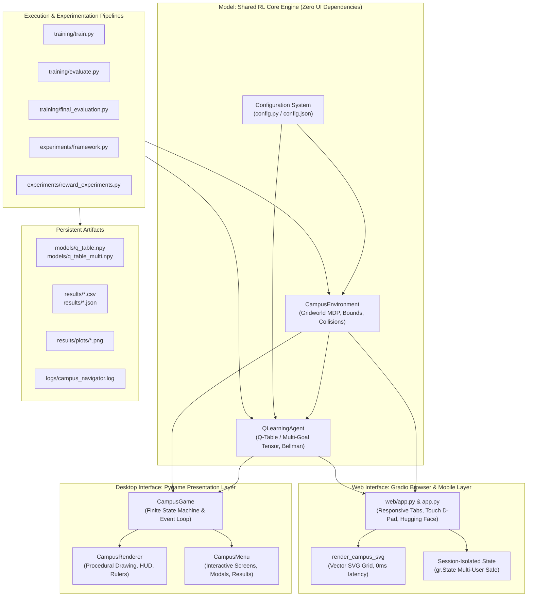
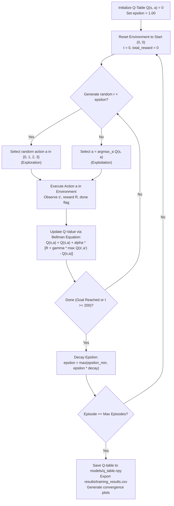

# 1. Project Title

# Campus Navigator: An Intelligent Path-Finding Game Using Q-Learning

> **Experiential Learning & Academic Demonstration Project**  
> *Autonomous Spatial Navigation via Tabular Reinforcement Learning, Goal-Conditioned Markov Decision Processes, and 2D Interactive Simulation*

[](https://www.python.org/)
[](LICENSE)
[](https://www.pygame.org/)
[](https://gradio.app/)
[](https://numpy.org/)
[](https://matplotlib.org/)
[](https://pandas.pydata.org/)
[-brightgreen.svg)](tests/)

---

## 2. Project Overview

**Campus Navigator** is an end-to-end educational Reinforcement Learning (RL) platform built from first principles in pure Python, NumPy, Matplotlib, Pandas, and Pygame. Instead of an abstract grid or generic maze, the environment models a realistic **$10 \times 10$ collegiate university campus**:

- **Autonomous Agent**: A student navigating between campus buildings.
- **Default Origin (Start)**: Campus Main Gate at coordinate `(0, 0)`.
- **Default Target (Destination)**: Central Library at coordinate `(9, 9)`.
- **Predefined Destinations (Phase 16)**: Central Library `(9, 9)`, Main Academic Block `(1, 8)`, Computer Lab `(4, 3)`, Cafeteria `(3, 2)`, and Sports Ground `(9, 0)`.
- **Impassable Buildings**: 19 discrete architectural obstacles (laboratories, lecture halls, administrative complexes) that block movement.
- **Enhanced Special Campus Zones (Phase 15)**:
  - **Safe Student Hubs** `[(3, 2), (7, 3)]`: Shaded pedestrian plazas and lounges granting a comfort bonus (`+2.0`).
  - **Crowded Corridor Zones** `[(3, 5), (6, 3), (7, 5)]`: Congested corridors introducing pedestrian delay penalties (`-2.0`).
  - **Hazard Zones** `[(2, 5), (5, 6), (8, 7)]`: Construction mud corridors and slippery walkways introducing severe penalties (`-10.0`).

Through repeated experiential interactions, the student agent learns the **mathematically optimal 18-step shortest path** from Main Gate to Central Library using **Tabular Q-Learning** without any hardcoded pathfinding heuristics (such as A* or Dijkstra's) or external RL frameworks (such as Gymnasium or Stable-Baselines3).

The system features a completely decoupled architecture, providing interactive graphical gameplay modes, headless terminal execution, an automated scientific experimentation suite, and a 100% verified test harness.

---

## 3. Problem Statement

Autonomous pathfinding in physical or virtual environments is traditionally solved using graph-search algorithms (e.g., A\*, Dijkstra's algorithm, Breadth-First Search). However, graph-search methods rely on three fundamental assumptions that do not hold in many real-world autonomous robotic systems:
1. **Complete Prior Map Knowledge**: The exact connectivity graph, cell costs, and obstacle coordinates must be provided *a priori*.
2. **Deterministic Topology**: Edge weights are assumed static, ignoring agent-environment interaction dynamics.
3. **No Direct Experiential Learning**: Graph-search algorithms do not learn from trial-and-error feedback, cannot adapt to scalar reward formulations, and do not improve their policies across successive operational episodes.

The central problem addressed by **Campus Navigator** is:
> *How can an autonomous agent, starting with zero knowledge of environment topography, transition dynamics, obstacle locations, or hazard boundaries, learn an optimal sequential navigation policy purely through scalar trial-and-error feedback?*

To solve this, the navigation task is formulated as a discrete **Markov Decision Process (MDP)** solved via **Tabular Q-Learning**, demonstrating how value iteration over state-action pairs enables an agent to discover safe, minimal-step pathways through complex constrained spaces.

---

## 4. Motivation

1. **Experiential Computer Science Pedagogy**: Reinforcement Learning is frequently taught through abstract mathematics (Bellman optimality, contraction mappings, stochastic approximation). Campus Navigator bridges the gap between theoretical equations and concrete software engineering by providing an interactive visual workbench.
2. **Realistic Environmental Modeling**: Standard gridworld examples use uniform step penalties ($-1$). Campus Navigator introduces heterogeneous terrain costs—safe relaxation hubs, crowded bottlenecks, and slippery hazards—forcing the agent to balance distance minimization against physical safety.
3. **Objective Human vs. Machine Comparison**: Providing both manual keyboard controls and autonomous AI playback on identical layouts allows students and researchers to compare human perceptual heuristics against mathematically optimal Bellman policies.
4. **Clean Software Engineering**: Demonstrating production-grade software patterns in academic AI: clean MVC decoupling, zero-dependency tabular implementations, goal-conditioned tensor slicing, structured JSON configuration, and automated test-driven verification.

---

## 5. Objectives

- **Develop a Discrete Campus MDP**: Formulate a $10 \times 10$ spatial gridworld capturing campus landmarks, impassable obstacles, and differentiated terrain zones.
- **Implement Tabular Q-Learning from Scratch**: Construct the action-value matrix $Q(s, a)$, Temporal Difference (TD) updates, and $\epsilon$-greedy exploration decay in vectorized NumPy without external machine learning dependencies.
- **Engineer Multi-Destination Capability (Phase 16)**: Implement a goal-conditioned 3D tensor $Q(g, s, a)$ allowing seamless navigation between any campus landmark without invalidating baseline single-destination policies.
- **Provide Decoupled Architectural Layers**: Separate the core mathematical environment and RL agent from the Pygame graphical presentation layer for fast headless benchmarking.
- **Deliver an Academic Presentation Interface (Phase 17)**: Build an $1100 \times 750$ GUI with collegiate coordinate rulers, real-time telemetry HUD, sinusoidal status indicators, and waypoint route numbering.
- **Conduct Rigorous Empirical Benchmarks (Phases 20–22)**: Measure training convergence across episode horizons (500, 1000, 2000), evaluate reward shaping profiles (A, B, C), and automatically generate standardized evaluation reports.
- **Ensure Enterprise-Grade Software Reliability (Phases 18–19)**: Protect all failure modes with graceful recovery screens and maintain a 100% passing test suite across all subsystems.

---

## 6. RL Concepts

Reinforcement learning centers on the formal cyclic interaction between a learner and its operating domain:

```text
                     ┌───────────────────────────┐
                     │        Environment        │
                     │    (CampusEnvironment)    │
                     └─────────────┬─────────────┘
                                   │ State S_t, Reward R_t
                                   ▼
                             ┌───────────┐
                             │   Agent   │
                             └─────┬─────┘
                                   │ Action A_t
                                   ▼
                     ┌───────────────────────────┐
                     │        Environment        │
                     └───────────────────────────┘
```

The fundamental concepts implemented throughout the system include:

1. **Agent**: The active decision-maker (`QLearningAgent`).
2. **Environment**: The discrete world containing landmarks, obstacles, and zones (`CampusEnvironment`).
3. **State ($s \in \mathcal{S}$)**: The agent's current position on the $10 \times 10$ campus grid, mapped to scalar indices $0 \dots 99$.
4. **Action ($a \in \mathcal{A}$)**: The movement selected by the agent: `0: UP`, `1: DOWN`, `2: LEFT`, `3: RIGHT`.
5. **Reward ($R_t \in \mathbb{R}$)**: The scalar feedback signal emitted by the environment following each transition.
6. **Policy ($\pi(a|s)$)**: The decision-making rule mapping states to actions. In greedy evaluation, $\pi^*(s) = \arg\max_a Q(s, a)$.
7. **Action-Value Function ($Q(s, a)$)**: Expected cumulative discounted return starting from state $s$, taking action $a$, and subsequently following policy $\pi$.
8. **Temporal Difference (TD) Error ($\delta_t$)**: The discrepancy between the updated return estimate (TD target) and current prediction:
   $$\delta_t = R_{t+1} + \gamma \max_{a'} Q(s_{t+1}, a') - Q(s_t, a_t)$$
9. **Exploration vs. Exploitation**: Managed via an $\epsilon$-greedy schedule decaying from $\epsilon_0 = 1.0$ (pure exploration) down to $\epsilon_{min} = 0.05$ (predominant exploitation).
10. **Discount Factor ($\gamma$)**: Dictates the present value of future rewards. Set to $\gamma = 0.90$.

For complete mathematical proofs and derivations, see [`docs/reinforcement_learning.md`](docs/reinforcement_learning.md).

---

## 7. System Architecture

Campus Navigator is engineered according to the **Model-View-Controller (MVC)** design pattern:



### Architectural Highlights
- **Dual Presentation Interfaces**: Both the desktop Pygame application and the browser-based Gradio web application interact with the exact same underlying RL components without duplicating algorithms.
- **Headless RL Core**: The RL environment and agent have zero dependencies on Pygame or web servers. Training, evaluation, and experiments run in high-speed pure Python/NumPy.
- **Session-Isolated Multi-User Web Safety**: Each browser tab maintains an isolated `CampusEnvironment` instance via Gradio's `gr.State`, allowing multiple users on mobile or desktop to play simultaneously without interfering with one another.
- **Finite State Machine**: The desktop GUI transitions cleanly between states: `STATE_MENU`, `STATE_TRAINING`, `STATE_PLAYING`, `STATE_WATCH_AI`, `STATE_RESULTS`, `STATE_HOW_RL_WORKS`, `STATE_SETTINGS`, and `STATE_ROUTE_SELECT`.
- **Fault Tolerance & Centralized Logging**: Runtime anomalies are caught and logged in [`logs/campus_navigator.log`](logs/campus_navigator.log) while user-friendly fallback screens prevent crashes.

For comprehensive architectural specifications, see [`docs/architecture.md`](docs/architecture.md).

---

## 8. Technology Stack

| Component | Technology | Version | Purpose |
|---|---|---|---|
| **Runtime Language** | Python | 3.8 – 3.12 | Core execution environment |
| **Numerical Computing** | NumPy | 1.26.4 | Vectorized Q-tables, multi-goal tensors, array math |
| **Desktop GUI Engine** | Pygame | 2.6.1 | 2D procedural rendering, event handling, animations |
| **Web & Mobile Interface** | Gradio | 6.x / 4.x+ | Responsive web app, touch controls, Hugging Face deployment |
| **Data Analysis** | Pandas | 2.3.3 | Rolling metrics, experiment logging, CSV manipulation |
| **Scientific Plotting** | Matplotlib | 3.10.9 | High-resolution convergence graphs and route plots |
| **Serialization** | Python `json` & `csv` | Standard Library | Hyperparameters, summaries, and episode datasets |
| **Testing Engine** | Python `unittest` | Standard Library | 86 unit, regression, integration, and web tests |
| **Logging Subsystem** | Python `logging` | Standard Library | Centralized runtime error tracing and audit logs |

---

## 9. Installation

### Prerequisites
- Python 3.8 or higher installed on Windows, macOS, or Linux.
- `pip` package manager.

### Step-by-Step Setup

1. **Clone or Download the Repository**:
   ```bash
   git clone https://github.com/your-username/campus-navigator.git
   cd "campus-navigator"
   ```

2. **Create and Activate a Virtual Environment** *(Recommended)*:
   ```bash
   # Windows (Command Prompt / PowerShell)
   python -m venv venv
   .\venv\Scripts\activate

   # Linux / macOS
   python3 -m venv venv
   source venv/bin/activate
   ```

3. **Install Dependencies**:
   ```bash
   pip install -r requirements.txt
   ```

4. **Verify Installation**:
   ```bash
   python run_all_tests.py
   ```
   *Expected output: `ALL TESTS PASSED (100% SUCCESS)` across 75 tests.*

---

## 10. Running the Project

Campus Navigator provides both an interactive graphical interface and command-line execution pipelines:

### 1. Interactive Graphical Interface
Launch the full desktop application ($1100 \times 750$ px):
```bash
python main.py
```

### 2. Headless Training Pipeline
Train the Q-learning agent in terminal mode without launching the Pygame window:
```bash
python main.py --train --episodes 1000
```
*Outputs: `models/q_table.npy` and `results/training_results.csv`.*

### 3. Policy Evaluation Pipeline
Evaluate the frozen Q-table over 100 deterministic test episodes ($\epsilon = 0.0$):
```bash
python main.py --eval
```
*Outputs: `results/evaluation_results.csv` and `results/evaluation_summary.json`.*

### 4. Convergence Plot Generation
Generate high-resolution Matplotlib performance charts:
```bash
python main.py --plot
```
*Outputs 5 charts to `results/plots/`.*

### 5. Horizon Benchmarking Experiments (Phase 20)
Execute the multi-horizon empirical benchmark (500, 1000, 2000 episodes):
```bash
python main.py --experiment
```
*Outputs: `results/experiments.csv`, `results/plots/experiment_comparison.png`, and `results/plots/experiment_learning_curves.png`.*

### 6. Reward Engineering Experiments (Phase 21)
Train and compare the three distinct reward function formulations (Profiles A, B, C):
```bash
python main.py --reward-exp
```
*Outputs: `results/reward_experiments.csv`, comparison charts, and route maps in `results/plots/`.*

### 7. Automated Final Evaluation Report (Phase 22)
Synthesize actual empirical data across training logs and experiments into an executive report:
```bash
python main.py --report
```
*Outputs: `results/final_report.json` and `results/final_results.csv`.*

### 8. Automated Test Suite Execution (Phase 19)
Execute the complete test suite across all 12 test modules (86 tests):
```bash
python run_all_tests.py
```
Or run the web application unit tests specifically:
```bash
python tests/test_web_app.py
```

### 9. Web Application & Mobile Touch Interface (Gradio)
Launch the browser-based, touch-friendly web deployment:
```bash
python web/app.py
# Or using the root entry point:
python app.py
```
Open `http://localhost:7860` in any web browser, or connect from an Android phone or iPhone on the same Wi-Fi network at `http://<YOUR_LOCAL_IP>:7860`.

---

## 11. Game Modes

The desktop application includes 8 distinct operational modes accessible via keyboard shortcuts or mouse clicks:

```text
+-------------------------------------------------------------------------------+
|                       CAMPUS NAVIGATOR - MAIN MENU                            |
+-------------------------------------------------------------------------------+
|  [1] Train AI            - Live animated exploration with telemetry & speeds  |
|  [2] Watch Trained AI    - Autonomous greedy policy playback (Optimal 18-step)|
|  [3] Play Game           - Manual keyboard navigation with step & safety costs|
|  [4] Training Results    - Scrollable dashboard with 7 metrics & 4 graphs     |
|  [5] How RL Works        - Visual viva study guide & mathematical proofs      |
|  [6] Settings            - Interactive hyperparameters & bounds validation    |
|  [ESC] Exit              - Terminate application                              |
+-------------------------------------------------------------------------------+
```

1. **Mode 1: Main Menu**: Central hub supporting single-key navigation (`1`–`6`, `ESC`), arrow key browsing, and mouse interactions.
2. **Mode 2: Train AI (Interactive)**: Visual training simulation displaying live agent exploration, coordinate tracking, real-time reward telemetry, dual progress/epsilon gauges, and speed controls (`[1] Slow`, `[2] Normal`, `[3] Fast`, `[SPACE] Pause`).
3. **Mode 3: Watch Trained AI**: Autonomous navigation under frozen policy ($\epsilon = 0.0$). The agent traces the optimal 18-step path to the Central Library. Users can press `[C]` to open the Route Selection modal and choose alternative campus landmarks.
4. **Mode 4: Play Game (Manual Human)**: Direct manual navigation using `WASD` or `Arrow Keys`. Traversal costs, hazard penalties, and obstacle collisions accumulate in real-time.
5. **Mode 5: Human vs. AI Performance Comparison**: Triggered automatically upon human goal arrival, displaying a side-by-side empirical benchmark contrasting steps taken, cumulative reward, elapsed time, and collision counts.
6. **Mode 6: Training Results Dashboard**: Scrollable performance viewer featuring 7 summary cards, 4 embedded Matplotlib charts, and an `[Open Folder]` operating system shortcut.
7. **Mode 7: How RL Works**: Interactive viva study guide detailing the 8-stage RL loop, Bellman equations, and core definitions.
8. **Mode 8: Settings & Configuration**: Full GUI configuration tool for adjusting grid size, learning rate, discount factor, and epsilon decay with strict validation guardrails.

For complete control mappings, see [`docs/user_manual.md`](docs/user_manual.md).

---

## 11B. Web Application & Mobile Deployment (Hugging Face Spaces)

In addition to the desktop Pygame interface, Campus Navigator features a **browser-based web deployment** built with **Gradio** and **vector SVG graphics**. It allows professors, students, and evaluators to access the complete Reinforcement Learning simulation from **Android phones, iPhones, iPads, Windows, and Mac laptops** via a public HTTPS URL.

### Web Architecture & Highlights
- **Single Source of Truth**: The web application imports and reuses the exact same `CampusEnvironment`, `QLearningAgent`, and Bellman TD equations from the shared RL core without algorithm duplication.
- **Session-Isolated Multi-User State**: Multiple users can navigate and train independently without cross-session data corruption via Gradio's `gr.State`.
- **Zero-Latency Vector SVG Grid**: Renders a crisp, responsive $10 \times 10$ campus grid that automatically adapts to phone screens ($360\text{px} - 440\text{px}$) with zero horizontal scrolling.
- **Touch-First Controls**: Large, finger-friendly directional D-pad buttons (`[UP]`, `[DOWN]`, `[LEFT]`, `[RIGHT]`) engineered specifically for mobile touchscreens.

### Web Interface Sections
1. **🏠 Home**: Executive academic summary of the Markov Decision Process formulation, specifications table, and architecture overview.
2. **🎮 Play Game**: Interactive human path-finding with destination selection, live reward telemetry, collision detection, and victory celebration.
3. **🤖 Watch AI**: Autonomous demonstration under pure exploitation ($\epsilon = 0.0$). Features a live **$Q(s, a)$ Values Inspector Table** revealing the highest expected return across all 4 actions for the current state.
4. **🏋️ Train AI**: Interactive training engine allowing users to configure episodes ($50 - 1500$), learning rate ($\alpha$), discount factor ($\gamma$), and $\epsilon$-decay. Generates real Matplotlib convergence curves and provides a downloadable `.npy` model file.
5. **📊 Results**: Dynamic display of empirical project benchmarks, KPIs, summary tables, and high-resolution training charts.
6. **📚 Learn RL**: Comprehensive viva preparation guide detailing the Bellman equation, parameter breakdowns, and exploration-exploitation trade-offs rendered in mathematical KaTeX.

### Step-by-Step Hugging Face Spaces Deployment Guide

To deploy the web application to a public HTTPS URL accessible on any phone or laptop:

1. **Create a Free Account on Hugging Face**:
   Navigate to [huggingface.co](https://huggingface.co) and sign in or create an account.

2. **Create a New Space**:
   - Go to [huggingface.co/new-space](https://huggingface.co/new-space).
   - Enter **Space Name**: `campus-navigator` (or your preferred name).
   - Select **Space SDK**: **Gradio**.
   - Select **Space Hardware**: Free CPU basic (2 vCPU, 16GB RAM is more than enough).
   - Select **Visibility**: **Public**.
   - Click **Create Space**.

3. **Upload / Push Project Files**:
   Clone the newly created Space or upload the required project files:
   ```text
   campus-navigator/
   ├── app.py                      # Root Hugging Face entry point
   ├── web/
   │   ├── __init__.py
   │   └── app.py                  # Full Gradio application
   ├── environment/
   │   ├── __init__.py
   │   └── campus_env.py           # 10x10 Campus Gridworld MDP
   ├── agent/
   │   ├── __init__.py
   │   └── q_learning.py           # Tabular Q-Learning Agent
   ├── models/
   │   ├── q_table.npy             # Trained baseline model
   │   └── q_table_multi.npy       # Trained multi-destination tensor
   ├── training/
   │   ├── __init__.py
   │   └── train.py                # Experiential training pipeline
   ├── results/                    # Empirical results and publication plots
   ├── config.py                   # Central configuration
   └── requirements.txt            # Python dependencies (gradio, numpy, pandas, matplotlib)
   ```

4. **Automatic Build & Launch**:
   - Hugging Face automatically detects `requirements.txt` and executes `app.py`.
   - The build process completes in approximately 1–2 minutes.
   - Once the status pill turns green (**Running**), your Space is live!

5. **Access and Share Public HTTPS URL**:
   - The Space URL will be: `https://huggingface.co/spaces/<your-username>/campus-navigator`.
   - Share this HTTPS link with evaluators or professors.
   - It opens smoothly in Safari on iPhone, Chrome on Android, and all desktop browsers.

### Mobile Phone Usage Guide
- **iPhone / iOS**: Open Safari or Chrome, enter the HTTPS URL. For full-screen app experience, tap **Share** > **Add to Home Screen**.
- **Android**: Open Chrome or Firefox, enter the HTTPS URL. Tap the three dots menu > **Install app** or **Add to Home screen**.
- **Touch Navigation**: Tap the large `[UP]`, `[DOWN]`, `[LEFT]`, `[RIGHT]` buttons to move the student agent cell by cell.
- **Orientation**: Supports both portrait mode (stacked layout) and landscape mode. No horizontal scrolling required.

---

## 12. Q-Learning Explanation

Q-Learning is a **model-free**, **off-policy**, **Temporal Difference (TD)** reinforcement learning algorithm. It learns the optimal action-value function $Q^*(s, a)$ directly from environmental transitions without requiring an explicit model of transition probabilities $P(s'|s, a)$ or reward distributions $R(s, a)$.

### The Bellman Optimality Equation
The algorithmic core of Q-Learning is the Bellman Optimality Equation:
$$Q^*(s, a) = \mathbb{E} \left[ R_{t+1} + \gamma \max_{a'} Q^*(s_{t+1}, a') \;\middle|\; s_t = s, a_t = a \right]$$

In tabular implementations, expected values are iteratively approximated via stochastic gradient-like Temporal Difference updates:
$$Q(s_t, a_t) \leftarrow Q(s_t, a_t) + \alpha \underbrace{\left[ R_{t+1} + \gamma \max_{a'} Q(s_{t+1}, a') - Q(s_t, a_t) \right]}_{\text{Temporal Difference Error } \delta_t}$$

Where:
- $Q(s_t, a_t)$ is the current estimate of expected cumulative return.
- $\alpha \in (0, 1]$ is the **Learning Rate** (default $\alpha = 0.10$).
- $R_{t+1}$ is the immediate scalar reward received from the environment.
- $\gamma \in [0, 1]$ is the **Discount Factor** (default $\gamma = 0.90$).
- $\max_{a'} Q(s_{t+1}, a')$ is the estimated maximum future return attainable from the next state.
- **Terminal State Handling**: If $s_{t+1}$ is a terminal goal state, no future actions exist, reducing the target to the immediate reward: $Q(s_t, a_t) \leftarrow Q(s_t, a_t) + \alpha [R_{t+1} - Q(s_t, a_t)]$.

### Convergence Guarantee
Under standard Robbins-Monro stochastic approximation conditions:
1. $\sum_{t=0}^\infty \alpha_t(s, a) = \infty$ (sufficient learning opportunity)
2. $\sum_{t=0}^\infty \alpha_t^2(s, a) < \infty$ (variance diminishing)
3. Every state-action pair $(s, a)$ is visited infinitely often through exploration.

The tabular estimate $Q_t(s, a)$ is mathematically proven to converge to the unique optimal action-value function $Q^*(s, a)$ as $t \to \infty$.

---

## 13. State Definition

The environment is modeled as a 2D discrete coordinate grid of size $H \times W = 10 \times 10$:

- **2D Coordinate State**: $s_{coord} = (r, c)$ where:
  - Row index $r \in \{0, 1, 2, \dots, 9\}$ (measured top-to-bottom).
  - Column index $c \in \{0, 1, 2, \dots, 9\}$ (measured left-to-right).
- **Total Discrete States**: $|\mathcal{S}| = 10 \times 10 = 100$ states.
- **1D Scalar State Index**: Mapped bijectively to a 1D index $s \in [0, 99]$ via:
  $$s = r \times W + c = r \times 10 + c$$
- **Inverse Coordinate Mapping**:
  $$r = \lfloor s / 10 \rfloor, \quad c = s \pmod{10}$$

### Goal-Conditioned Multi-Destination State Space (Phase 16)
To support dynamic navigation across multiple landmarks without modifying the single-goal API, the state space is augmented with the target landmark index $g \in \{0, 1, 2, 3, 4\}$:
$$s_{augmented} = (g, s) \in \{0, \dots, 4\} \times \{0, \dots, 99\}$$
This maps directly to the 3D tensor $Q(g, s, a)$ of shape `(5, 100, 4)`.

---

## 14. Action Definition

The agent possesses a discrete action space of $|\mathcal{A}| = 4$ cardinal moves:

| Action ID | Name | Coordinate Delta $(\Delta r, \Delta c)$ | Direction |
|:---:|:---:|:---:|:---:|
| `0` | **UP** | $(-1, 0)$ | North / Upward |
| `1` | **DOWN** | $(+1, 0)$ | South / Downward |
| `2` | **LEFT** | $(0, -1)$ | West / Leftward |
| `3` | **RIGHT** | $(0, +1)$ | East / Rightward |

### Deterministic Transition Dynamics & Collision Physics
Given state $s = (r, c)$ and action $a \in \{0, 1, 2, 3\}$, the candidate next state is:
$$s_{next} = (r + \Delta r_a, c + \Delta c_a)$$

1. **Perimeter Wall Boundary**: If $s_{next}$ falls outside the grid ($r_{next} < 0$, $r_{next} \ge 10$, $c_{next} < 0$, or $c_{next} \ge 10$):
   - Transition is blocked: $s_{t+1} \leftarrow s_t$
   - Collision penalty is applied (`-10.0`)
2. **Building Obstacle**: If $s_{next} \in \mathcal{O}$ (where $\mathcal{O}$ is the set of 19 building obstacle coordinates):
   - Transition is blocked: $s_{t+1} \leftarrow s_t$
   - Collision penalty is applied (`-10.0`)
3. **Valid Walkway**: If $s_{next}$ is within bounds and unoccupied by buildings:
   - Transition succeeds: $s_{t+1} \leftarrow s_{next}$

---

## 15. Reward Design

The reward function $R(s, a, s')$ provides the scalar feedback that shapes the agent's policy. Campus Navigator uses a composite reward structure that balances path length against traversal safety:

$$R(s, a, s') = R_{base}(s') + R_{shaping}(s, s') + R_{collision}(s, a) + R_{zone}(s')$$

### Default Reward Parameters
- **Goal Reached (Central Library `(9, 9)`)**: `+100.0`
- **Step Cost**: `-1.0` per movement (incentivizes minimal path length).
- **Manhattan Distance Shaping**:
  - `+5.0` if Manhattan distance to goal strictly decreases: $\|s' - g\|_1 < \|s - g\|_1$
  - `-3.0` if Manhattan distance to goal strictly increases: $\|s' - g\|_1 > \|s - g\|_1$
- **Obstacle / Wall Collision**: `-10.0`
- **Safe Student Hubs `[(3, 2), (7, 3)]`**: `+2.0` comfort bonus
- **Crowded Pedestrian Corridors `[(3, 5), (6, 3), (7, 5)]`**: `-2.0` congestion penalty
- **Unsafe Mud / Construction Hazards `[(2, 5), (5, 6), (8, 7)]`**: `-10.0` hazard penalty

### Evaluated Reward Profiles (Phase 21)

| Parameter | Profile A (Simple) | Profile B (Efficient) | Profile C (Safety-Aware) |
|---|:---:|:---:|:---:|
| **Goal Reward** | `+100.0` | `+100.0` | `+100.0` |
| **Step Cost** | `-1.0` | `-1.0` | `-1.0` |
| **Distance Shaping** | Disabled | `+5.0` (closer) / `-3.0` (farther) | `+5.0` (closer) / `-3.0` (farther) |
| **Obstacle Collision** | `-10.0` | `-10.0` | `-20.0` (Doubled penalty) |
| **Hazard Zone Penalty** | `-1.0` (Default step) | `-10.0` | `-15.0` (Severe hazard penalty) |

For detailed comparative analysis, see [`docs/experiments.md`](docs/experiments.md).

---

## 16. Hyperparameters

| Hyperparameter | Symbol | Default | Supported Range | Algorithmic Significance |
|---|:---:|:---:|:---:|---|
| **Campus Grid Size** | $H \times W$ | `10 x 10` | $8 \times 8 \dots 16 \times 16$ | Spatial dimensions of the environment |
| **Training Episodes** | $E$ | `1000` | $50 \dots 20000$ | Total training iterations executed |
| **Learning Rate** | $\alpha$ | `0.10` | $0.001 \dots 1.0$ | Step size weighting new TD targets vs. prior Q-values |
| **Discount Factor** | $\gamma$ | `0.90` | $0.0 \dots 1.0$ | Present weight of future delayed returns |
| **Initial Epsilon** | $\epsilon_0$ | `1.00` | $0.0 \dots 1.0$ | Initial probability of taking a random exploratory action |
| **Minimum Epsilon** | $\epsilon_{min}$ | `0.05` | $0.0 \dots 1.0$ | Exploration floor ensuring late-stage policy stabilization |
| **Epsilon Decay Rate** | $\lambda$ | `0.995` | $0.5 \dots 0.9999$ | Multiplicative decay per episode: $\epsilon \leftarrow \max(\epsilon_{min}, \epsilon \cdot \lambda)$ |
| **Max Steps / Episode** | $T_{max}$ | `200` | $25 \dots 1000$ | Horizon truncation threshold preventing infinite loops |

All hyperparameters are dynamically configurable via [`config.json`](config.json) or the in-game Settings screen, protected by validation guardrails preventing invalid mathematical inputs.

---

## 17. Training Process

The experiential training lifecycle proceeds as follows:



### Empirical Convergence Phases
1. **Initial Exploration ($\text{Episodes } 1 \dots 50$, $\epsilon > 0.77$)**: The agent navigates predominantly at random, incurring collisions and negative step costs while discovering obstacle positions.
2. **First Goal Discovery & Value Propagation ($\text{Episodes } 50 \dots 200$, $0.77 > \epsilon > 0.36$)**: The $+100.0$ goal reward propagates backward across adjacent coordinates via Bellman updates.
3. **Policy Refinement ($\text{Episodes } 200 \dots 600$, $0.36 > \epsilon > 0.05$)**: The agent transitions to exploitation. Average episode length drops from $\sim 45$ steps toward the optimal 18 steps.
4. **Asymptotic Convergence ($\text{Episodes } 600 \dots 1000$, $\epsilon = 0.05$)**: The Q-table stabilizes. The greedy policy consistently produces the optimal 18-step trajectory with 0 collisions.

---

## 18. Evaluation Metrics

Model performance is evaluated across 5 primary quantitative metrics:

1. **Success Rate (%)**: Percentage of evaluation episodes successfully reaching the destination without exceeding the step limit:
   $$\text{Success Rate} = \frac{N_{reached}}{N_{total}} \times 100\%$$
2. **Average Steps to Goal**: Mean number of movement steps required to navigate from origin to destination:
   $$\overline{\text{Steps}} = \frac{1}{N_{reached}} \sum_{i=1}^{N_{reached}} T_i$$
3. **Average Cumulative Reward**: Mean scalar return accumulated per episode:
   $$\overline{R} = \frac{1}{N} \sum_{i=1}^N \sum_{t=0}^{T_i} R_t$$
4. **Collision Rate**: Mean number of invalid wall or building collisions per episode:
   $$\overline{C} = \frac{1}{N} \sum_{i=1}^N C_i$$
5. **Path Optimality Ratio**: Evaluated steps divided by the theoretical Manhattan shortest path distance ($D_{optimal} = 18$ steps):
   $$\text{Optimality Ratio} = \frac{\overline{\text{Steps}}}{D_{optimal}} = \frac{18.0}{18.0} = 1.000$$

### Evaluation Protocol
Evaluation is conducted over **100 deterministic test episodes** under **frozen policy weights** ($\epsilon = 0.0$). The Q-table is verified to undergo **zero mutation** during evaluation.

---

## 19. Results

The performance metrics below are **factual measured values** extracted directly from actual execution logs in [`results/final_report.json`](results/final_report.json) and [`results/experiments.csv`](results/experiments.csv):

### Executive Summary (Final Evaluation — Phase 22)

```text
====================================================================
           CAMPUS NAVIGATOR: FINAL EVALUATION BENCHMARK
====================================================================
 PROJECT            : Campus Navigator
 ALGORITHM          : Tabular Q-Learning
 ENVIRONMENT        : 10x10 Campus Grid (19 Buildings, 8 Special Zones)
 TRAINING EPISODES  : 1000 episodes
 EVALUATION HORIZON : 100 test episodes (Frozen Weights, epsilon=0.0)
 FINAL SUCCESS RATE : 100.0% (100/100 reached)
 AVERAGE REWARD     : +172.0
 AVERAGE STEPS      : 18.0 steps (Exact Shortest Path)
 COLLISION RATE     : 0.00 hits/episode
 OPTIMALITY RATIO   : 1.000 (18 / 18 steps)
====================================================================
```

### Optimal 18-Step Trajectory
The trained agent executes the following mathematically optimal sequence of 19 coordinates from Campus Gate `(0, 0)` to Central Library `(9, 9)`:
$$\begin{aligned}
(0,0) &\to (1,0) \to (2,0) \to (3,0) \to (3,1) \to (3,2) \to (3,3) \to (4,3) \to (4,4) \to (5,4) \\
      &\to (6,4) \to (7,4) \to (8,4) \to (8,5) \to (8,6) \to (8,7) \to (9,7) \to (9,8) \to (9,9)
\end{aligned}$$

### Empirical Horizon Comparison (Phase 20)

| Metric | Experiment 1 (500 eps) | Experiment 2 (1000 eps) | Experiment 3 (2000 eps) |
|---|:---:|:---:|:---:|
| **Training Success Rate** | 95.4% (477/500) | 96.9% (969/1000) | 98.7% (1973/2000) |
| **Evaluated Success Rate ($\epsilon=0$)** | **100.0%** (100/100) | **100.0%** (100/100) | **100.0%** (100/100) |
| **Training Average Reward** | +99.69 | +132.34 | +152.46 |
| **Evaluated Average Reward** | +170.0 | +170.0 | **+172.0** |
| **Training Average Steps** | 41.92 steps | 32.18 steps | 25.26 steps |
| **Evaluated Average Steps** | **18.0 steps** | **18.0 steps** | **18.0 steps** |
| **Training Collision Rate** | 7.48 hits/ep | 4.07 hits/ep | 2.13 hits/ep |
| **Evaluated Collision Rate** | **0.00 hits/ep** | **0.00 hits/ep** | **0.00 hits/ep** |
| **Execution Time** | 0.47 seconds | 0.69 seconds | 1.15 seconds |

### Reward Engineering Comparison (Phase 21)

| Metric | Profile A (Simple) | Profile B (Efficient) | Profile C (Safety-Aware) |
|---|:---:|:---:|:---:|
| **Goal Reward / Step Cost** | `+100.0` / `-1.0` | `+100.0` / `-1.0` | `+100.0` / `-1.0` |
| **Distance Shaping** | None | `+5.0` / `-3.0` | `+5.0` / `-3.0` |
| **Obstacle / Hazard Penalty** | `-10.0` / `-1.0` | `-10.0` / `-10.0` | `-20.0` / `-15.0` |
| **Evaluated Success Rate** | **100.0%** | **100.0%** | **100.0%** |
| **Evaluated Steps to Goal** | **18.0 steps** | **18.0 steps** | **18.0 steps** |
| **Evaluated Cumulative Return** | +83.0 | +172.0 | +167.0 |
| **Total Training Collisions** | 4,214 hits | 4,001 hits | **3,999 hits** (Lowest) |
| **Total Hazard Traversals** | 1,158 visits | 1,115 visits | **1,089 visits** (Lowest) |

---

## 20. Limitations

1. **Discrete State Space Constraint**: The tabular representation scales as $\mathcal{O}(|\mathcal{S}| \times |\mathcal{A}|)$. While ideal for discrete gridworlds ($10 \times 10 = 100$ states), it does not scale directly to continuous coordinate systems without function approximation.
2. **Static Environmental Assumptions**: Building obstacles, safe zones, and hazard corridors remain stationary during an episode. Dynamic moving obstacles (e.g., wandering pedestrians, campus shuttle carts) are not modeled in the current MDP.
3. **Full Observability**: The agent receives exact $(r, c)$ coordinates. Partially Observable Markov Decision Processes (POMDPs) where the agent only senses local raycast lidar or visual camera inputs are beyond the tabular scope.
4. **Re-training for Structural Alterations**: Adding or removing permanent campus buildings alters the underlying transition graph, requiring retraining to update the Q-table.

---

## 21. Future Enhancements

1. **Deep Q-Networks (DQN)**: Replace tabular storage with a Deep Q-Network featuring Experience Replay and a Target Network to support continuous coordinate inputs and large-scale campus maps.
2. **Dynamic Obstacles & Moving Pedestrians**: Introduce autonomous agents governed by Markov random walks or A* patrolling patterns to simulate real-time pedestrian avoidance.
3. **Multi-Agent Reinforcement Learning (MARL)**: Deploy multiple student agents simultaneously learning shared or competitive navigation policies with mutual collision avoidance.
4. **Continuous Action Spaces via Actor-Critic (DDPG / PPO)**: Upgrade from 4 cardinal discrete steps to continuous steering angles, acceleration, and velocity vectors.
5. **3D Interactive Campus Simulation**: Port the 2D grid mechanics into a 3D physical environment using Panda3D, PyBullet, or Unity ML-Agents.

---

## 22. Project Structure

```text
Campus Navigator/
│
├── main.py                         # Application CLI & Pygame GUI launcher
├── app.py                          # Hugging Face Spaces root web entry point
├── config.py                       # Global layout, landmark, and default hyperparameters
├── config.json                     # Dynamic runtime settings persisted from UI
├── requirements.txt                # Production dependencies (pygame, gradio, numpy, matplotlib, pandas)
├── run_all_tests.py                # Master automated test runner (12 suites, 86 tests)
├── README.md                       # Master comprehensive documentation
│
├── web/                            # Web & Mobile Deployment Layer (Gradio)
│   ├── __init__.py
│   └── app.py                      # Responsive Gradio application (6 tabs, mobile touch D-pad)
│
├── environment/                    # MDP Model Layer
│   ├── __init__.py
│   └── campus_env.py               # 10x10 Gridworld physics, landmarks, bounds, rewards
│
├── agent/                          # Reinforcement Learning Agent
│   ├── __init__.py
│   └── q_learning.py               # Tabular Q-Learning, multi-goal tensor, epsilon-greedy
│
├── training/                       # Execution Pipelines
│   ├── __init__.py
│   ├── train.py                    # Experiential training pipeline with CSV logging
│   ├── evaluate.py                 # Frozen-weight deterministic evaluation (eps=0.0)
│   └── final_evaluation.py         # Phase 22 executive report generator
│
├── experiments/                    # Scientific Benchmarking Framework
│   ├── __init__.py
│   ├── framework.py                # Phase 20 horizon benchmarks (500/1000/2000 episodes)
│   └── reward_experiments.py       # Phase 21 reward profile experiments (A, B, C)
│
├── visualization/                  # Matplotlib Visualization Engine
│   ├── __init__.py
│   └── plots.py                    # Multi-panel convergence graphs & route maps
│
├── game/                           # Pygame Presentation Layer (MVC View/Controller)
│   ├── __init__.py
│   ├── game.py                     # Central game loop, event dispatcher, state manager
│   ├── menu.py                     # Menus, settings, modals, results dashboard
│   └── renderer.py                 # 2D procedural graphics, coordinate rulers, HUD
│
├── utils/                          # Resilience & Error Handling
│   ├── __init__.py
│   └── logger.py                   # Structured runtime file & console logger
│
├── models/                         # Serialized Model Weights
│   ├── q_table.npy                 # Trained baseline (100, 4) Q-table for Library
│   └── q_table_multi.npy           # Trained multi-goal (5, 100, 4) tensor
│
├── results/                        # Empirical Datasets & Publication Artifacts
│   ├── training_results.csv        # 1000-episode raw training telemetry
│   ├── evaluation_results.csv      # 100-episode frozen policy evaluation data
│   ├── evaluation_summary.json     # Baseline evaluation summary
│   ├── experiments.csv             # Phase 20 empirical horizon benchmark dataset
│   ├── reward_experiments.csv      # Phase 21 reward profile comparison dataset
│   ├── final_report.json           # Phase 22 executive evaluation report
│   ├── final_results.csv           # Phase 22 structured comparative results dataset
│   └── plots/                      # High-resolution publication charts
│       ├── reward_vs_episode.png
│       ├── steps_vs_episode.png
│       ├── success_rate.png
│       ├── collision_rate.png
│       ├── moving_average_reward.png
│       ├── experiment_comparison.png
│       ├── experiment_learning_curves.png
│       ├── reward_profile_comparison.png
│       ├── reward_learning_curves.png
│       └── reward_routes_comparison.png
│
├── logs/                           # Runtime Logging
│   └── campus_navigator.log        # Central structured runtime log
│
├── tests/                          # Complete Automated Test Harness (Phase 19)
│   ├── __init__.py
│   ├── test_environment.py         # CampusEnvironment physics & reward assertions
│   ├── test_agent.py               # QLearningAgent Bellman updates & tensor slicing
│   ├── test_training.py            # Training pipeline lifecycle & CSV exports
│   ├── test_evaluation.py          # Zero-epsilon policy evaluation & zero-mutation check
│   ├── test_game.py                # Pygame GUI navigation & human controls
│   ├── test_phase18_error_handling.py # 10 major failure scenarios & logger verification
│   ├── test_multi_destinations.py  # 5 landmarks & goal-conditioned Q-tensor
│   ├── test_phase17_ui.py          # Coordinate rulers, HUD status, animations
│   ├── test_experiments.py         # Horizon benchmarking framework verification
│   ├── test_reward_experiments.py  # Reward profile framework verification
│   ├── test_final_evaluation.py    # Phase 22 final report JSON/CSV validation
│   └── test_web_app.py             # Gradio web app, session state, SVG & D-pad tests
│
└── docs/                           # In-Depth Theoretical & Technical Documentation
    ├── architecture.md             # System architecture, MVC decoupling, state machine
    ├── reinforcement_learning.md   # Mathematical RL proofs, Bellman derivations, viva guide
    ├── implementation.md           # Software engineering, class breakdown, data structures
    ├── experiments.md              # Empirical experiment methodologies and factual data
    └── user_manual.md              # Installation, GUI controls, CLI reference, and FAQ
```

---

## 📚 In-Depth Technical Guides

For deeper academic and architectural exploration, please consult our dedicated technical documentation:

- 🏛️ [**System Architecture & Design Patterns**](docs/architecture.md): Complete MVC decoupling, finite state machine specifications, dataflows, and fault-tolerance mechanisms.
- 🧠 [**Reinforcement Learning Mathematical Foundation**](docs/reinforcement_learning.md): Formal MDP formulation, Bellman optimality derivations, tabular convergence proofs, and college viva examination Q&A.
- 💻 [**Software Implementation & Engineering**](docs/implementation.md): Deep-dive into class designs, coordinate transformations, goal-conditioned tensor indexing, and test harness structure.
- 🔬 [**Empirical Experiments & Scientific Benchmarks**](docs/experiments.md): Comprehensive methodology and factual data from the 500/1000/2000 episode and reward engineering benchmarks.
- 🎮 [**User Manual & Operational Guide**](docs/user_manual.md): Step-by-step installation instructions, complete keybinding tables, CLI reference, settings guide, and troubleshooting FAQ.
