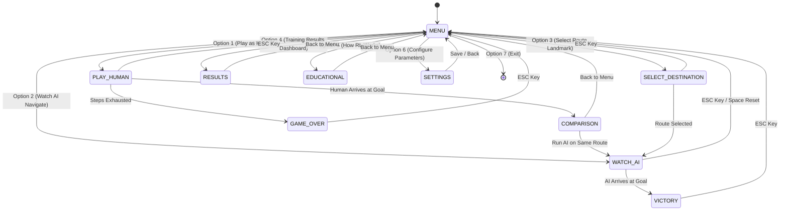

# System Architecture: Campus Navigator

This document details the software architecture, engineering patterns, component decoupling, and lifecycle pipelines of **Campus Navigator: An Intelligent Path-Finding Game Using Q-Learning**.

---

## 1. Architectural Philosophy & Decoupling

Campus Navigator is engineered following a strict **Model-View-Controller (MVC)** and **Decoupled Engine** pattern. The Reinforcement Learning environment and agent are 100% decoupled from the Pygame graphical presentation layer.

```mermaid
flowchart TD
    subgraph CoreRL ["Core Reinforcement Learning Engine (Headless / Zero GUI Dependencies)"]
        Env["CampusEnvironment<br/>(MDP State Space, Physics, Rewards)"]
        Agent["QLearningAgent<br/>(Q-Table / Multi-Goal Tensor, Bellman Update)"]
        Config["Configuration & Layout<br/>(config.py, config.json)"]
    end

    subgraph Pipelines ["Automated Execution & Benchmarking Pipelines"]
        Train["training/train.py<br/>(Experiential Training Loop)"]
        Eval["training/evaluate.py<br/>(Frozen Policy Evaluation)"]
        FinalEval["training/final_evaluation.py<br/>(Phase 22 Final Report Engine)"]
        ExpFramework["experiments/framework.py<br/>(Phase 20 Horizon Benchmarks)"]
        RewFramework["experiments/reward_experiments.py<br/>(Phase 21 Reward Profiles)"]
    end

    subgraph Persistence ["Persistence & Artifacts"]
        Models[("models/q_table.npy<br/>models/q_table_multi.npy")]
        Results[("results/training_results.csv<br/>results/experiments.csv<br/>results/reward_experiments.csv<br/>results/final_report.json")]
        Plots[("results/plots/*.png")]
        Logs[("logs/campus_navigator.log")]
    end

    subgraph Presentation ["Presentation Layer (Pygame 1100x750 GUI)"]
        Game["CampusNavigatorGame<br/>(State Machine, Event Loop)"]
        Renderer["CampusRenderer<br/>(Procedural 2D Grid, HUD, Animations)"]
        Menu["CampusMenu<br/>(8 Navigation Screens, Dashboards, Modals)"]
    end

    Config --> Env
    Config --> Agent
    Env <--> Agent
    Train --> Env & Agent
    Eval --> Env & Agent
    FinalEval --> Env & Agent
    ExpFramework --> Env & Agent
    RewFramework --> Env & Agent

    Train --> Models & Results
    ExpFramework --> Results & Plots
    RewFramework --> Results & Plots
    FinalEval --> Results

    Game --> Menu & Renderer
    Game --> Env & Agent
    Game -.-> Logs
```



### Architectural Guarantees:
1. **Headless Execution**: The environment ([`environment/campus_env.py`](file:///c:/Users/Nagaraj/Desktop/Campus%20Navigator/environment/campus_env.py)) and agent ([`agent/q_learning.py`](file:///c:/Users/Nagaraj/Desktop/Campus%20Navigator/agent/q_learning.py)) contain **zero Pygame imports**. They execute in pure Python/NumPy, enabling high-speed training (~0.0006s per episode) and automated headless testing on remote servers or CI/CD pipelines without display monitors.
2. **Frozen Weights Guarantee**: During evaluation and playback modes, `agent.epsilon` is explicitly locked to `0.0`, and weight update routines are bypassed to prevent policy corruption.
3. **Data Integrity**: All experiments log exact measured telemetry to CSV and JSON formats before rendering charts, adhering strictly to reproducible empirical science.

---

## 2. Component Breakdown

### 2.1 Virtual Campus Environment (`environment/campus_env.py`)
- **Role**: Simulates the virtual university campus as a discrete Markov Decision Process (MDP).
- **Key Responsibilities**:
  - Tracks student agent coordinates $(r, c)$ on a $10 \times 10$ grid ($100$ discrete states).
  - Validates movements against grid boundaries and 19 impassable building obstacles.
  - Implements zone property rules (Safe Student Hubs, Crowded Plazas, Hazard/Mud Zones).
  - Computes immediate scalar rewards via configurable profiles or default distance shaping.
  - Supports multiple predefined campus destination landmarks (Library, Main Block, Computer Lab, Cafeteria, Sports Ground).
  - Provides a terminal ASCII grid visualizer for instant debugging.

### 2.2 Q-Learning Agent (`agent/q_learning.py`)
- **Role**: Autonomous decision-maker implementing Tabular Q-Learning.
- **Key Responsibilities**:
  - Manages primary Q-table tensor $Q(s, a)$ of shape `(100, 4)` initialized to zero.
  - Manages goal-conditioned multi-destination tensor $Q(g, s, a)$ of shape `(5, 100, 4)`.
  - Executes $\epsilon$-greedy action selection balancing stochastic exploration and greedy exploitation.
  - Updates action-values via the temporal difference (TD) Bellman optimality equation.
  - Controls exponential exploration decay down to a defined minimum floor ($\epsilon_{min} = 0.05$).
  - Serializes and deserializes weights to `.npy` binary arrays with corruption/NaN detection.

### 2.3 Presentation & Interaction Layer (`game/`)
- **`game/game.py`**:
  - Master controller managing the 60 FPS clock, Pygame event polling, and finite state machine.
  - Dispatches states: `MENU`, `PLAY_HUMAN`, `PLAY_AI`, `WATCH_AI`, `RESULTS`, `EDUCATIONAL`, `SETTINGS`, `COMPARISON`, `SELECT_DESTINATION`, `VICTORY`, `GAME_OVER`.
- **`game/renderer.py`**:
  - Procedural 2D graphics engine rendering the $1100 \times 750$ window with coordinate rulers $(0..9)$.
  - Renders building blocks with shadows, designated hazard hatchings, and glowing student hubs.
  - Displays dynamic HUD panels: episode counters, cumulative rewards, step budgets, and epsilon gauges.
  - Animates goal arrival ripples, victory overlays, and step-by-step route lines with numbered waypoint pins.
- **`game/menu.py`**:
  - Interactive multi-screen menu system with clean button components, hover states, and keybinds.
  - Manages Settings screen (`config.json`), Results Dashboard, "How RL Works" viva screen, and Human vs. AI comparison table.

---

## 3. Finite State Machine (Game States)



---

## 4. Pipeline Dataflow

### 4.1 Training Dataflow
```text
CampusEnvironment.reset()
        │
        ▼
   State S_t ──────────────► agent.choose_action(S_t) (epsilon-greedy)
                                      │
                                      ▼
                                   Action A_t
                                      │
                                      ▼
                        CampusEnvironment.step(A_t)
                                      │
                 ┌────────────────────┴────────────────────┐
                 ▼                                         ▼
            Next State S_{t+1}                      Scalar Reward R_{t+1}
                 │                                         │
                 └────────────────────┬────────────────────┘
                                      ▼
                          agent.update(S_t, A_t, R_{t+1}, S_{t+1})
                                      │
                                      ▼
                         Q(S_t, A_t) updated via Bellman rule
                                      │
                                      ▼
                      Episode terminates? (Goal / Max Steps)
                                      │
                    No ───────────────┼───────────────► Yes
                    │                                   │
                    ▼                                   ▼
             Loop next step                      agent.decay_epsilon()
                                                 Log to results/training_results.csv
                                                 Save models/q_table.npy
```

### 4.2 Policy Evaluation Dataflow
```text
Load models/q_table.npy ──► Set agent.epsilon = 0.0 (Zero Exploration)
                                      │
                                      ▼
                     Execute 100 deterministic test episodes
                                      │
                                      ▼
                   Measure: Success Rate, Steps, Reward, Collisions
                                      │
                                      ▼
                     Extract 18-step optimal route coordinates
                                      │
                                      ▼
                     Persist to results/final_report.json
                     Persist to results/final_results.csv
```

---

## 5. Resilience & Fault-Tolerance Architecture

Campus Navigator is designed with zero-crash error handling across 10 critical operational failure scenarios:

| Failure Scenario | Resilience Mechanism | Recovery Behavior |
|---|---|---|
| **Missing Model File** | `os.path.exists()` check in `load_model()` | Displays `STATE_NO_MODEL` warning card in GUI; invites user to train first. |
| **Corrupted Weights** | File size verification, NaN/Inf scan, shape validation | Rejects corrupted tensor cleanly, falls back to default zero table, logs error. |
| **Missing Metrics CSV** | File existence and non-zero byte validation | Displays placeholder dashboard card prompting user to run training. |
| **Corrupted `config.json`** | JSON parser wrapped in `try...except json.JSONDecodeError` | Reverts to hardcoded defaults in `config.py`, logs diagnostic warning. |
| **Out-of-Bounds Action** | Integer type and range checks against `[0..3]` | Clamps agent position, applies collision penalty `-10.0`, preserves state. |
| **Invalid State Coordinates** | Clamping against `[0..rows-1, 0..cols-1]` | Logs warning, clamps invalid coordinate to nearest valid grid cell. |
| **Headless Environment** | `pygame.error` caught during display initialization | Prints clear terminal diagnostic with CLI alternatives (`--train`, `--eval`, `SDL_VIDEODRIVER=dummy`). |
| **Training Interruption** | `try...except KeyboardInterrupt` wrapping training loop | Catches Ctrl+C cleanly, saves completed episodes and partial Q-table safely. |
| **Missing Plot Images** | Asset existence verification before loading textures | Renders procedural placeholder cards with instructions to generate plots. |
| **Empty Result Datasets** | DataFrame length check (`len(df) < 2`) | Rejects empty CSVs with informative user guidance. |

Centralized structured runtime logging is handled by [`utils/logger.py`](file:///c:/Users/Nagaraj/Desktop/Campus%20Navigator/utils/logger.py), writing UTF-8 diagnostic records to [`logs/campus_navigator.log`](file:///c:/Users/Nagaraj/Desktop/Campus%20Navigator/logs/campus_navigator.log).
